# Learn Java ☕

<div align="center">

[](https://opensource.org/licenses/MIT)
[](https://openjdk.org/projects/jdk/25/)
[](https://github.com/TheLearningHubOrg/learn-java/actions/workflows/ci.yml)
[](https://github.com/TheLearningHubOrg/learn-java/releases)
[](https://openjdk.org/jeps/444)
[](https://docs.gradle.org/current/userguide/gradle_wrapper.html)

**A guide from your first `java` command to staff-level work on the JVM, built around a runnable Java 25 service.**  
Toolchain and JVM model, collections and streams, records, sealed types and pattern matching, generics, exceptions, virtual threads and structured concurrency, I/O and HTTP, JDBC and testing, garbage collection, JFR profiling, AOT startup and container deployment.

[Getting Started](#1-stage-1-toolchain-jvm-model--language-basics) • [Collections & Streams](#2-stage-2-methods-collections-streams--packages) • [OOP & Types](#3-stage-3-oop-records-sealed-types-generics--exceptions) • [Concurrency](#4-stage-4-concurrency-virtual-threads--the-java-memory-model) • [I/O & Testing](#5-stage-5-io-networking-persistence--testing) • [Performance](#6-stage-6-performance-profiling-security--deployment) • [Interview Prep](#7-stage-7-staff-java-engineer-interview-handbook--cheatsheet)

<br/>

<a href="https://www.buymeacoffee.com/manthanank">
  
</a>

</div>

---

All code in this guide is Java, the native language of the platform. The starter project is a plain-JDK HTTP service (no framework) built with the Gradle wrapper and tested with JUnit Jupiter, so every concept is visible in code you can read end to end. Where a framework or another JVM language changes the picture, the text says so.

## 🗺️ 7-Stage Pedagogical Roadmap


| Stage | Focus Domain | Core Concepts & Engineering Outcomes |
| :--- | :--- | :--- |
| **Stage 1** | **Toolchain, JVM Model & Language Basics** | Install a JDK 25 build, use `java`, `javac`, `jshell`, `jar` and `javap`; run compact source files with `void main()` and `IO.println`; primitive types, `var`, operators, `String` and text blocks, `switch` expressions; class loading, bytecode and tiered JIT; Gradle wrapper anatomy. Outcome: build, test and run the starter service. |
| **Stage 2** | **Methods, Collections, Streams & Packages** | Overloading and varargs, arrays, `List`/`Set`/`Map`, sequenced collections, `equals`/`hashCode`, lambdas and `java.util.function`, `Stream`, `Collectors.groupingBy`, gatherers, `Optional`, packages, access modifiers, `module-info.java` and `import module`. Outcome: write data-processing code in both loop and stream style and know when each wins. |
| **Stage 3** | **OOP, Records, Sealed Types, Generics & Exceptions** | Classes and constructors (flexible constructor bodies), interfaces with default methods, records with compact constructors, enums, `sealed` hierarchies, record patterns and exhaustive `switch`, generics with wildcards and PECS, erasure, checked vs unchecked exceptions, try-with-resources, immutability. Outcome: model a domain with types the compiler checks. |
| **Stage 4** | **Concurrency, Virtual Threads & the Java Memory Model** | `Thread`, `ExecutorService`, `Executors.newVirtualThreadPerTaskExecutor()`, `CompletableFuture`, locks and atomics, `ConcurrentHashMap`, happens-before, `volatile`, structured concurrency (preview) and `ScopedValue`. Outcome: serve thousands of blocking requests without a reactive framework. |
| **Stage 5** | **I/O, Networking, Persistence & Testing** | `java.nio.file`, `HttpClient` and `HttpServer`, JSON handling, JDBC with `PreparedStatement` and transactions, connection pools, JUnit Jupiter, parameterised tests, Mockito, Testcontainers. Outcome: a tested service that talks to a real database. |
| **Stage 6** | **Performance, Profiling, Security & Deployment** | G1, ZGC and Shenandoah, heap sizing in containers, JFR and JDK Mission Control, JMH, `jlink` runtimes, AOT cache, secure coding and dependency hygiene, multi-stage Docker images. Outcome: a small, observable, non-root container image. |
| **Masterclasses** | **Loom internals, GC tuning, startup and AOT, Panama, flagship service** | Deep dives into the newest parts of the platform, each with a worked example, a trade-off table and a production checklist. |
| **Stage 7** | **Staff Interview Handbook** | 40+ interview Q&As across core concepts, internals, design and debugging scenarios, plus a one-page cheatsheet. |

---

## 🆕 Java Versions, What's New & Migration

Java ships a feature release every six months, in March and September. Every fourth release (every two years since Java 17) is a long-term support (LTS) release that vendors such as Eclipse Adoptium, Oracle, Amazon, Microsoft, Azul and Red Hat patch for years. Most production systems move from LTS to LTS. This guide targets **Java 25 LTS**, the current LTS, and flags anything that needs a later release or a preview flag.

### V.1 Release Timeline

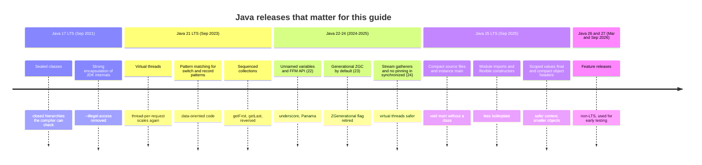

### V.2 Compatibility Matrix

| Java | Released | Support | Gradle that can run on it | Spring Boot | Notes |
| --- | --- | --- | --- | --- | --- |
| 8 | Mar 2014 | LTS, extended vendor support only | any 8.x | 2.x (EOL) | Legacy. No modules, no `var`. |
| 11 | Sep 2018 | LTS, extended vendor support | 5.0+ | 2.x (EOL) | First LTS after the module system. |
| 17 | Sep 2021 | LTS | 7.3+ | 3.x, 4.x (minimum) | Minimum for Spring Boot 3 and 4 and JUnit 6. |
| 21 | Sep 2023 | LTS | 8.5+ | 3.2+, 4.x | Virtual threads. Many teams still run it. |
| **25** | **Sep 2025** | **LTS (this guide)** | **9.1+** | 4.x | Current LTS. The starter uses Gradle 9.8.2 and Temurin 25. |
| 26 | Mar 2026 | Feature release, superseded | current stable | current stable | Non-LTS. |
| 27 | Sep 2026 | Latest feature release | current stable | current stable | Non-LTS. Next LTS is planned for Java 29 (Sep 2027). |

Support end dates differ per vendor and per support contract, so check your distribution's own lifecycle page before you plan an upgrade. Gradle can also compile for a newer JDK than the one it runs on, through [toolchains](https://docs.gradle.org/current/userguide/toolchains.html).

### V.3 What's New in Java 25

#### Compact source files and instance `main` (JEP 512)

A source file may now contain methods and fields with no enclosing class. The compiler wraps them in an implicit class, imports every package exported by `java.base`, and the launcher accepts an instance `main` with no parameters. `java.lang.IO` gives console helpers.

```java
// Before (any version)
import java.util.List;

public class Hello {
    public static void main(String[] args) {
        List<String> names = List.of("Ada", "Lin");
        System.out.println("Hello, " + names);
    }
}
```

```java
// After (Java 25): save as Hello.java, run with: java Hello.java
void main() {
    List<String> names = List.of("Ada", "Lin");
    IO.println("Hello, " + names);
}
```

#### Module import declarations (JEP 511)

`import module M;` imports every public top-level type in every package that module `M` exports, including packages it re-exports with `requires transitive`. It works in ordinary classpath code too; the importing code does not have to be a module.

```java
// Before
import java.util.List;
import java.util.Map;
import java.util.function.Function;
import java.util.stream.Collectors;
```

```java
// After
import module java.base;
```

When two modules export a type with the same simple name (for example `java.util.List` and `java.awt.List` through `java.desktop`), add a single-type import such as `import java.util.List;` to resolve the ambiguity; single-type imports win.

#### Flexible constructor bodies (JEP 513)

Statements may now appear before `super(...)` or `this(...)`, as long as they do not read `this`. You can validate arguments before paying for the superclass constructor, and you can assign the subclass's own fields early.

```java
// Before: validation had to hide inside a static helper
class PositiveCounter extends Counter {
    PositiveCounter(int start) {
        super(requirePositive(start));
    }
    private static int requirePositive(int n) {
        if (n <= 0) throw new IllegalArgumentException("start must be positive");
        return n;
    }
}
```

```java
// After (Java 25)
class PositiveCounter extends Counter {
    PositiveCounter(int start) {
        if (start <= 0) throw new IllegalArgumentException("start must be positive");
        super(start);
    }
}
```

#### Scoped values are final (JEP 506)

`ScopedValue` shares an immutable value with code called inside a bounded scope, including child threads started by structured concurrency. Unlike `ThreadLocal`, the binding cannot be changed by callees and disappears when the scope ends, so there is nothing to `remove()` and no leak across pooled threads.

```java
// Before: ThreadLocal, mutable and easy to leak on pooled threads
static final ThreadLocal<String> REQUEST_ID = new ThreadLocal<>();

void handle(String id) {
    REQUEST_ID.set(id);
    try {
        process();
    } finally {
        REQUEST_ID.remove();
    }
}
```

```java
// After (Java 25)
static final ScopedValue<String> REQUEST_ID = ScopedValue.newInstance();

void handle(String id) {
    ScopedValue.where(REQUEST_ID, id).run(this::process);
}

void process() {
    String id = REQUEST_ID.get(); // NoSuchElementException if not bound
}
```

#### Compact object headers (JEP 519)

On 64-bit HotSpot an object header is usually 12 bytes (mark word plus compressed class pointer). `-XX:+UseCompactObjectHeaders` shrinks it to 8 bytes. It is a product option in Java 25 but off by default. Heaps full of small objects shrink noticeably, so measure it in your own load test before you turn it on.

```bash
# Before: default headers
java -jar app.jar
# After: opt in, then compare heap usage and GC frequency in JFR
java -XX:+UseCompactObjectHeaders -jar app.jar
```

#### Ahead-of-time cache in one step (JEPs 483, 514, 515)

Java 24 added an AOT cache that stores loaded and linked classes from a training run. Java 25 adds `-XX:AOTCacheOutput`, which records and creates the cache in one command, and stores method profiles so the JIT warms up sooner.

```bash
# Before (Java 24): record a configuration, then create the cache
java -XX:AOTMode=record -XX:AOTConfiguration=app.aotconf -jar app.jar
java -XX:AOTMode=create -XX:AOTConfiguration=app.aotconf -XX:AOTCache=app.aot -jar app.jar

# After (Java 25): one training run
java -XX:AOTCacheOutput=app.aot -jar app.jar
# Production runs use the cache
java -XX:AOTCache=app.aot -jar app.jar
```

#### Features from 22-24 you get when you jump from 21

| Release | Feature | One-line effect |
| --- | --- | --- |
| 22 | Unnamed variables and patterns (`_`) | `catch (IOException _)`, `case Point(var x, _)` |
| 22 | Foreign Function & Memory API final | Call C libraries without JNI (see M4) |
| 22 | Launch multi-file source programs | `java Main.java` compiles sibling source files on demand |
| 23 | Markdown documentation comments | `///` comments written in Markdown |
| 23 | Generational ZGC is the only ZGC mode | `-XX:+UseZGC` is enough |
| 24 | Stream gatherers final | `stream.gather(Gatherers.windowFixed(3))` |
| 24 | Virtual threads no longer pin in `synchronized` | Old `synchronized` code is safe on virtual threads |
| 24 | Class-File API final | Read and write bytecode without ASM |
| 24 | ML-KEM and ML-DSA | Post-quantum key encapsulation and signatures in the JDK |

### V.4 Migration Guide (Java 21 → Java 25)

```bash
# 1. Install a JDK 25 build and confirm it.
java -version          # openjdk version "25.0.x" ... LTS

# 2. Gradle: move the wrapper to a version that runs on 25 (9.1 or newer).
./gradlew wrapper --gradle-version 9.8.2
./gradlew --version

# 3. Point the build at 25. In build.gradle.kts:
#      java { toolchain { languageVersion = JavaLanguageVersion.of(25) } }
#      tasks.withType<JavaCompile>().configureEach { options.release = 25 }
#    Maven: <maven.compiler.release>25</maven.compiler.release>

# 4. Find uses of JDK internals that the module system now blocks.
jdeps --jdk-internals --multi-release 25 build/libs/app.jar

# 5. Optional automated refactoring with OpenRewrite (current rewrite-migrate-java).
./gradlew rewriteRun -Drewrite.activeRecipe=org.openrewrite.java.migrate.UpgradeToJava25

# 6. Build with every warning on, then run the full test suite.
./gradlew build    # the starter compiles with -Xlint:all -Werror

# 7. Update container base images.
#      FROM eclipse-temurin:25-jdk AS build
#      FROM eclipse-temurin:25-jre AS runtime
```

Then check these by hand:

1. Remove `-XX:+ZGenerational` and `-XX:-ZGenerational` from start scripts. Since Java 24 ZGC is generational only and the flag is obsolete.
2. Upgrade bytecode-generating libraries (Byte Buddy, Mockito, Lombok, Hibernate, Spring) to versions that declare Java 25 support. Old versions fail with errors such as `Unsupported class file major version 69`.
3. Mockito's inline mock maker attaches an agent at runtime. Since Java 21 that prints a dynamic agent loading warning. Configure Mockito as a `-javaagent` in the test task.
4. Code that calls native libraries through JNI or FFM prints a restricted-method warning since Java 24. Add `--enable-native-access=ALL-UNNAMED` (or your module name) to the launcher.
5. Any `System.setSecurityManager` call now throws `UnsupportedOperationException`. Remove it.

### V.5 Deprecations & Breaking Changes

| Version | Deprecated / removed | Replacement | What breaks and how to fix it |
| --- | --- | --- | --- |
| 16 | Boxed-primitive constructors (`new Integer(5)`) deprecated for removal | `Integer.valueOf(5)` or autoboxing | Compiler warning; switch to the factory. |
| 17 | Security Manager deprecated for removal (JEP 411) | Process isolation, containers, OS controls | Warnings at startup if enabled. |
| 18 | Finalization deprecated for removal (JEP 421) | `try`-with-resources, `java.lang.ref.Cleaner` | `finalize()` still runs but is scheduled to go. |
| 19 | `Locale` constructors deprecated | `Locale.of("en", "GB")` | Deprecation warning. |
| 20 | `URL` constructors deprecated | `URI.create(s).toURL()` | Deprecation warning; `URI` also validates syntax. |
| 20 | `Thread.stop()` throws `UnsupportedOperationException` | Interruption and cooperative cancellation | Runtime exception where `stop()` is still called. |
| 21 | Dynamic agent loading warns (JEP 451) | Pass agents with `-javaagent` at startup | Warning on stderr; future releases will refuse. |
| 23 | String templates (preview in 21-22) withdrawn | `String.formatted`, `StringBuilder`, text blocks | Code compiled with `--enable-preview` on 21/22 does not compile. |
| 23 | `sun.misc.Unsafe` memory access deprecated for removal (JEP 471) | `VarHandle`, FFM `MemorySegment` | Warnings at first use since 24 (JEP 498). |
| 24 | Non-generational ZGC removed (JEP 490) | `-XX:+UseZGC` alone | `-XX:+ZGenerational` prints an obsolete-flag warning. |
| 24 | Security Manager permanently disabled (JEP 486) | As above | `System.setSecurityManager` throws. |
| 24 | JNI use warns (JEP 472) | `--enable-native-access` | Warning at first native call. |
| 25 | 32-bit x86 port removed (JEP 503) | 64-bit JDK | No 32-bit x86 builds. |
| 26 | Applet API removed (JEP 504) | None | Classes in `java.applet` are gone. |
| 26 | Deep-reflection writes to `final` fields warn (JEP 500) | Constructors, builders, `VarHandle` on non-final fields | Warnings from serialisation or DI libraries that mutate finals; upgrade them. |

---

## 📋 Table of Contents

- [🆕 Java Versions, What's New & Migration](#-java-versions-whats-new--migration)
- [1. Stage 1: Toolchain, JVM Model & Language Basics](#1-stage-1-toolchain-jvm-model--language-basics)
  - [1.1 What Java Is: JDK, JRE, JVM and Bytecode](#11-what-java-is-jdk-jre-jvm-and-bytecode)
  - [1.2 Installing a JDK 25 and Choosing a Distribution](#12-installing-a-jdk-25-and-choosing-a-distribution)
  - [1.3 Your First Programs: Compact Source Files, the Launcher and `jshell`](#13-your-first-programs-compact-source-files-the-launcher-and-jshell)
  - [1.4 `javac`, `java`, `jar` and `javap` by Hand](#14-javac-java-jar-and-javap-by-hand)
  - [1.5 Primitive Types, Wrappers and `var`](#15-primitive-types-wrappers-and-var)
  - [1.6 Operators, Integer Overflow and Floating-Point Arithmetic](#16-operators-integer-overflow-and-floating-point-arithmetic)
  - [1.7 Strings, Text Blocks and Formatting](#17-strings-text-blocks-and-formatting)
  - [1.8 Control Flow: `if`, Loops and `switch` Expressions](#18-control-flow-if-loops-and-switch-expressions)
  - [1.9 How the JVM Runs Your Code: Class Loading, Bytecode and the JIT](#19-how-the-jvm-runs-your-code-class-loading-bytecode-and-the-jit)
  - [1.10 Build Tools: the Gradle Wrapper and Maven](#110-build-tools-the-gradle-wrapper-and-maven)
  - [1.11 Line-by-Line Breakdown of the Starter Project](#111-line-by-line-breakdown-of-the-starter-project)
  - [1.12 Pitfalls](#112-pitfalls)
  - [1.13 Best Practices](#113-best-practices)
  - [1.14 Hands-on Exercise](#114-hands-on-exercise)
- [2. Stage 2: Methods, Collections, Streams & Packages](#2-stage-2-methods-collections-streams--packages)
  - [2.1 Methods: Parameters, Overloading, Varargs and Pass-by-Value](#21-methods-parameters-overloading-varargs-and-pass-by-value)
  - [2.2 Arrays and the `Arrays` Utility Class](#22-arrays-and-the-arrays-utility-class)
  - [2.3 The Collections Framework: `List`, `Set`, `Map` and Sequenced Collections](#23-the-collections-framework-list-set-map-and-sequenced-collections)
  - [2.4 `equals`, `hashCode` and How `HashMap` Works](#24-equals-hashcode-and-how-hashmap-works)
  - [2.5 Immutable vs Unmodifiable Collections](#25-immutable-vs-unmodifiable-collections)
  - [2.6 Lambdas, Method References and Functional Interfaces](#26-lambdas-method-references-and-functional-interfaces)
  - [2.7 Streams: Pipelines, Collectors and Gatherers](#27-streams-pipelines-collectors-and-gatherers)
  - [2.8 `Optional` Done Right](#28-optional-done-right)
  - [2.9 Packages, Access Modifiers and the Module System](#29-packages-access-modifiers-and-the-module-system)
  - [2.10 Walkthrough: the Generic Repository in the Starter](#210-walkthrough-the-generic-repository-in-the-starter)
  - [2.11 Pitfalls](#211-pitfalls)
  - [2.12 Best Practices](#212-best-practices)
  - [2.13 Hands-on Exercise](#213-hands-on-exercise)
- [3. Stage 3: OOP, Records, Sealed Types, Generics & Exceptions](#3-stage-3-oop-records-sealed-types-generics--exceptions)
  - [3.1 Classes, Objects and Constructors](#31-classes-objects-and-constructors)
  - [3.2 Inheritance, Interfaces and Polymorphism](#32-inheritance-interfaces-and-polymorphism)
  - [3.3 Records: Data Carriers with Validation](#33-records-data-carriers-with-validation)
  - [3.4 Enums: Constants with Behaviour](#34-enums-constants-with-behaviour)
  - [3.5 Sealed Types and Pattern Matching](#35-sealed-types-and-pattern-matching)
  - [3.6 Generics: Type Parameters, Wildcards and PECS](#36-generics-type-parameters-wildcards-and-pecs)
  - [3.7 Type Erasure and Its Consequences](#37-type-erasure-and-its-consequences)
  - [3.8 Exceptions: Checked, Unchecked and `try`-with-resources](#38-exceptions-checked-unchecked-and-try-with-resources)
  - [3.9 Immutability and Defensive Design](#39-immutability-and-defensive-design)
  - [3.10 Objects in Memory: Stack, Heap, References and `null`](#310-objects-in-memory-stack-heap-references-and-null)
  - [3.11 Walkthrough: the JSON Writer and Pattern-Matching `switch`](#311-walkthrough-the-json-writer-and-pattern-matching-switch)
  - [3.12 Pitfalls](#312-pitfalls)
  - [3.13 Best Practices](#313-best-practices)
  - [3.14 Hands-on Exercise](#314-hands-on-exercise)
- [4. Stage 4: Concurrency, Virtual Threads & the Java Memory Model](#4-stage-4-concurrency-virtual-threads--the-java-memory-model)
- [5. Stage 5: I/O, Networking, Persistence & Testing](#5-stage-5-io-networking-persistence--testing)
- [6. Stage 6: Performance, Profiling, Security & Deployment](#6-stage-6-performance-profiling-security--deployment)
- [M1. Masterclass: Virtual Threads and Structured Concurrency Internals](#m1-masterclass-virtual-threads-and-structured-concurrency-internals)
- [M2. Masterclass: Garbage Collection and Memory Tuning](#m2-masterclass-garbage-collection-and-memory-tuning)
- [M3. Masterclass: Startup, AOT Cache and Native Images](#m3-masterclass-startup-aot-cache-and-native-images)
- [M4. Masterclass: Project Panama, Foreign Memory and the Vector API](#m4-masterclass-project-panama-foreign-memory-and-the-vector-api)
- [M5. Masterclass: Flagship Blueprint, a Production Catalogue Service](#m5-masterclass-flagship-blueprint-a-production-catalogue-service)
- [7. Stage 7: Staff Java Engineer Interview Handbook & Cheatsheet](#7-stage-7-staff-java-engineer-interview-handbook--cheatsheet)
  - [7.1 Core Concepts (Q1-Q2)](#71-core-concepts-q1-q2)
  - [7.5 Staff Cheatsheet](#75-staff-cheatsheet)
- [🧪 Example Projects](#-example-projects)
- [📝 Cheat Sheets](#-cheat-sheets)
- [📚 Resources](#-resources)
- [🤝 Contributing](#-contributing)
- [📄 License](#-license)
- [🙏 Acknowledgments](#-acknowledgments)
- [🌐 Connect with me](#-connect-with-me)
- [☕ Support](#-support)

---

## 1. Stage 1: Toolchain, JVM Model & Language Basics

This stage installs a JDK, runs Java without a build tool, explains what the JVM does with your code, and covers the language core: types, operators, strings and control flow. No prior Java is assumed; some experience with any programming language helps. By the end you can build, test and run the starter service with `./gradlew build` and explain each line of its entry point.

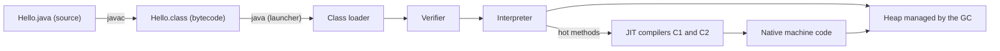

### 1.1 What Java Is: JDK, JRE, JVM and Bytecode

Java is three things that people often mix up:

| Term | What it is | What you use it for |
| --- | --- | --- |
| **Java language** | The syntax and rules defined by the Java Language Specification (JLS). | Writing `.java` source files. |
| **JVM** | A virtual machine defined by the JVM Specification. It loads `.class` files and runs their bytecode. HotSpot is the JVM inside almost every JDK build. | Running compiled code on any OS and CPU. |
| **JDK** | The development kit: JVM, class library (`java.base`, `java.net.http`, ...) and tools (`javac`, `jar`, `jshell`, `jlink`, `jcmd`, `jfr`). | Everything. Install a JDK, not a JRE. |
| **JRE** | A runtime without the compilers. Oracle stopped shipping a separate JRE with Java 11; some vendors still publish JRE images for containers. | Production containers (`eclipse-temurin:25-jre`), or a custom runtime built with `jlink`. |

`javac` does not produce machine code. It produces **bytecode**, a compact instruction set for a stack machine. The JVM interprets that bytecode at first and compiles the hot parts to native code while the program runs. That split is why the same `app.jar` runs on Linux x64, macOS on Apple silicon and Windows, and why a Java process gets faster during its first seconds or minutes of load ("warm-up").

**OpenJDK** is the open-source project where Java is developed. Vendors build and test OpenJDK and ship it as distributions: Eclipse Temurin, Amazon Corretto, Microsoft Build of OpenJDK, Azul Zulu, Red Hat build of OpenJDK, Oracle OpenJDK and Oracle JDK. They share the same code base and pass the same compatibility kit (TCK); they differ in licence, support length and which platforms they build for. This guide uses Temurin.

Java compared with neighbours you may know:

| | Java | Kotlin | C# / .NET | Go |
| --- | --- | --- | --- | --- |
| Compiles to | JVM bytecode | JVM bytecode (also JS, native) | CIL for the CLR | Native binary |
| Memory | Garbage collected | Garbage collected | Garbage collected | Garbage collected |
| Null safety | Runtime (`NullPointerException`); annotations help | In the type system | Nullable reference types (warnings) | No null for value types; nil pointers exist |
| Lightweight concurrency | Virtual threads | Coroutines (also virtual threads) | `async`/`await` | Goroutines |
| Startup | Tens to hundreds of ms; AOT cache and native image shrink it | Same as Java | Similar; NativeAOT available | Milliseconds |

### 1.2 Installing a JDK 25 and Choosing a Distribution

Install any OpenJDK 25 build. The commands below use Temurin.

```bash
# macOS (Homebrew)
brew install --cask temurin@25

# Windows (winget)
winget install EclipseAdoptium.Temurin.25.JDK

# Linux and macOS: SDKMAN manages several JDKs side by side
curl -s "https://get.sdkman.io" | bash
sdk list java                 # find the newest 25.x identifier ending in -tem
sdk install java 25.0.5-tem   # use the identifier the list shows
sdk use java 25.0.5-tem       # switch the current shell

# Debian or Ubuntu with the Adoptium apt repository configured
sudo apt-get install temurin-25-jdk

# Any OS with Docker: no install at all
docker run --rm -it eclipse-temurin:25-jdk jshell
```

Check the result:

```bash
java -version
# openjdk version "25.0.5" 2025-... LTS
# OpenJDK Runtime Environment Temurin-25.0.5+8 (build 25.0.5+8-LTS)
javac -version
# javac 25.0.5
echo "$JAVA_HOME"   # build tools and IDEs read this; point it at the JDK directory
```

`java -version` prints to stderr, which matters if you pipe it. If `java` and `javac` report different versions, two JDKs are on your `PATH`; fix `PATH` or `JAVA_HOME` before going further, otherwise you compile with one version and run with another.

| Choose | When |
| --- | --- |
| The current LTS (25) | Production services, libraries that others depend on, anything with a support contract. |
| The latest feature release (27 at the time of writing) | Trying new and preview features, testing your code early against the next LTS. |
| An older LTS (17, 21) | Only when a platform you deploy to forces it. Plan the upgrade. |

### 1.3 Your First Programs: Compact Source Files, the Launcher and `jshell`

Since Java 25 a first program needs no class declaration. This file is in the repo at [`examples/HelloCompact.java`](examples/HelloCompact.java):

```java
// Stage 1: a compact source file (final in JDK 25). Run it with no build step:
//   java examples/HelloCompact.java Ada
// There is no class declaration and no imports: the file is wrapped in an
// implicit class, and every package exported by java.base is imported.

void main(String[] args) {
    String name = args.length > 0 ? args[0] : "world";
    int feature = Runtime.version().feature();

    IO.println("Hello, " + name + "!");
    IO.println("Running on Java " + feature + " (" + System.getProperty("java.vendor") + ")");

    var primes = List.of(2, 3, 5, 7, 11);
    int sum = 0;
    for (int p : primes) {
        sum += p;
    }
    IO.println("Sum of " + primes + " = " + sum);

    if (sum != 28) {
        throw new IllegalStateException("expected 28, got " + sum);
    }
}
```

```bash
java examples/HelloCompact.java Ada
# Hello, Ada!
# Running on Java 25 (Eclipse Adoptium)
# Sum of [2, 3, 5, 7, 11] = 28
```

| Line / API | Role | What happens at runtime |
| :--- | :--- | :--- |
| `java examples/HelloCompact.java` | Source-file mode of the launcher | The launcher compiles the file in memory and runs it. No `.class` file is written. |
| `void main(String[] args)` | Instance main method | The launcher creates the implicit class with its no-argument constructor and calls `main`. A `main` with a `String[]` parameter is preferred over one without. |
| `IO.println(...)` | `java.lang.IO`, new in 25 | Writes to `System.out` followed by a line separator. `IO.readln("prompt> ")` reads a line. |
| `Runtime.version().feature()` | Version API | Returns `25` for any 25.x build. Use it instead of parsing `java.version`. |
| `var primes = List.of(...)` | Local type inference | The compiler infers `List<Integer>`. The variable is still statically typed. |
| `for (int p : primes)` | Enhanced for loop plus unboxing | Iterates with an `Iterator`; each `Integer` is unboxed to `int`. |
| `throw new IllegalStateException(...)` | Self-check | A non-zero exit code makes CI fail if the arithmetic is ever wrong. |

The launcher can also run several source files: since Java 22, `java Main.java` compiles other `.java` files in the same directory tree when `Main` refers to them. This covers scripts and small tools. Once you need dependencies or tests, use a build tool (1.10).

`jshell` is the REPL. It is the fastest way to check how an API behaves:

```text
$ jshell
jshell> var xs = new java.util.ArrayList<>(List.of(3, 1, 2))
xs ==> [3, 1, 2]
jshell> xs.sort(null)
jshell> xs
xs ==> [1, 2, 3]
jshell> 0.1 + 0.2
$4 ==> 0.30000000000000004
jshell> /vars
|    ArrayList<Integer> xs = [1, 2, 3]
|    double $4 = 0.30000000000000004
jshell> /exit
```

Useful commands: `/help`, `/vars`, `/methods`, `/imports`, `/edit` (opens an editor for a snippet), `/save file.jsh`, `/open file.jsh`, `/exit`. Tab completes names and shows method signatures.

### 1.4 `javac`, `java`, `jar` and `javap` by Hand

Build tools run these commands for you. Running them once by hand shows what a build does.

```text
greeter/
└── src/
    └── com/example/greeter/
        ├── Main.java
        └── Greeter.java
```

```java
// src/com/example/greeter/Greeter.java
package com.example.greeter;

public final class Greeter {
    private final String greeting;

    public Greeter(String greeting) {
        this.greeting = greeting;
    }

    public String greet(String name) {
        return greeting + ", " + name + "!";
    }
}
```

```java
// src/com/example/greeter/Main.java
package com.example.greeter;

public class Main {
    public static void main(String[] args) {
        var greeter = new Greeter("Hello");
        for (String name : args) {
            System.out.println(greeter.greet(name));
        }
    }
}
```

```bash
cd greeter
javac -d out --release 25 $(find src -name '*.java')   # compile into out/
java -cp out com.example.greeter.Main Ada Lin          # run from the class directory
# Hello, Ada!
# Hello, Lin!

jar --create --file greeter.jar --main-class com.example.greeter.Main -C out .
java -jar greeter.jar Ada                              # run the jar
# Hello, Ada!

javap -c -p -cp out com.example.greeter.Greeter        # disassemble the bytecode
```

The `javap` output for `greet` (abridged; constant-pool numbers vary) shows that string concatenation compiles to a single `invokedynamic` call (`makeConcatWithConstants`), not to a `StringBuilder` chain as it did before Java 9:

```text
  public java.lang.String greet(java.lang.String);
    Code:
       0: aload_0
       1: getfield      #7    // Field greeting:Ljava/lang/String;
       4: aload_1
       5: invokedynamic #13,  0 // InvokeDynamic #0:makeConcatWithConstants:...
      10: areturn
```

| Command / flag | Role |
| --- | --- |
| `javac -d out` | Writes `.class` files into `out/`, creating directories that mirror the package (`out/com/example/greeter/Main.class`). |
| `--release 25` | Compiles against the Java 25 API and emits class file version 69. Prefer it over `-source`/`-target`, which do not check API usage. |
| `java -cp out <class>` | Puts `out/` on the class path and runs the class with that fully qualified name. |
| `jar --main-class` | Writes `Main-Class` into `META-INF/MANIFEST.MF` so `java -jar` knows where to start. |
| `javap -c -p` | Prints bytecode (`-c`) including private members (`-p`). |

The directory layout must match the package: a class in package `com.example.greeter` lives in `com/example/greeter/`. The class name must match the file name for public classes.

### 1.5 Primitive Types, Wrappers and `var`

Java has eight primitive types. They hold values directly and cannot be `null`. Everything else is a reference to an object on the heap.

| Type | Size | Range / precision | Default (fields) | Wrapper | Literal |
| --- | --- | --- | --- | --- | --- |
| `boolean` | JVM-specific | `true`, `false` | `false` | `Boolean` | `true` |
| `byte` | 8 bit | -128 to 127 | `0` | `Byte` | `(byte) 7` |
| `short` | 16 bit | -32,768 to 32,767 | `0` | `Short` | `(short) 7` |
| `char` | 16 bit | UTF-16 code unit 0 to 65,535 | `'\u0000'` | `Character` | `'A'`, `'é'` |
| `int` | 32 bit | about ±2.1 billion | `0` | `Integer` | `42`, `0x2A`, `0b101010`, `1_000_000` |
| `long` | 64 bit | about ±9.2 × 10^18 | `0L` | `Long` | `42L` |
| `float` | 32 bit | about 7 decimal digits | `0.0f` | `Float` | `3.14f` |
| `double` | 64 bit | about 15-16 decimal digits | `0.0` | `Double` | `3.14`, `1e-9` |

Local variables have no default; using one before assignment is a compile error (`variable x might not have been initialized`). Fields and array elements get the defaults above.

**Boxing.** Collections hold objects, so `int` values are boxed into `Integer` automatically when you add them to a `List<Integer>` and unboxed when you read them. Boxing allocates (except for cached small values) and unboxing a `null` throws `NullPointerException`:

```java
import java.util.HashMap;
import java.util.Map;

public class Boxing {
    public static void main(String[] args) {
        Map<String, Integer> stock = new HashMap<>();
        stock.put("apples", 3);

        int apples = stock.get("apples");       // unboxing: fine
        Integer pears = stock.get("pears");     // null: no entry
        System.out.println(apples + " " + pears);

        int boom = stock.get("pears");          // NullPointerException while unboxing
        System.out.println(boom);
    }
}
```

`Integer.valueOf` caches the values -128 to 127, so `==` on two boxed `Integer` objects appears to work for small numbers and fails for larger ones. Always compare boxed numbers with `equals` or unbox first.

```java
Integer a = 127, b = 127;
Integer c = 128, d = 128;
System.out.println(a == b);       // true  (same cached object)
System.out.println(c == d);       // false (two different objects)
System.out.println(c.equals(d));  // true
```

**`var`** (Java 10) infers the type of a local variable from its initialiser. The type is fixed at compile time; `var` is not dynamic typing.

```java
var count = 10;                       // int
var names = new ArrayList<String>();  // ArrayList<String>
var entry = Map.entry("k", 1);        // Map.Entry<String, Integer>
// var nothing = null;                // compile error: cannot infer type
// var list = new ArrayList<>();      // compiles, but infers ArrayList<Object>
```

Use `var` when the type is obvious from the right-hand side or too long to be useful. Spell the type out when it tells the reader something the initialiser hides, such as `long total = sum(values)`.

### 1.6 Operators, Integer Overflow and Floating-Point Arithmetic

Java's operators look like C's. The traps are in the numeric rules:

```java
import java.math.BigDecimal;
import java.math.RoundingMode;

public class Numbers {
    public static void main(String[] args) {
        System.out.println(7 / 2);          // 3     integer division truncates toward zero
        System.out.println(-7 / 2);         // -3
        System.out.println(-7 % 2);         // -1    remainder takes the sign of the dividend
        System.out.println(Math.floorMod(-7, 2)); // 1 use this for "always positive" buckets
        System.out.println(7 / 2.0);        // 3.5   one double operand makes it double

        int big = Integer.MAX_VALUE;
        System.out.println(big + 1);        // -2147483648, silent wrap-around
        try {
            Math.addExact(big, 1);
        } catch (ArithmeticException e) {
            System.out.println(e.getMessage()); // integer overflow
        }

        long millisPerYear = 365 * 24 * 60 * 60 * 1000;   // overflows: int arithmetic first
        long fixed = 365L * 24 * 60 * 60 * 1000;          // long arithmetic from the start
        System.out.println(millisPerYear + " vs " + fixed); // 1471228928 vs 31536000000

        System.out.println(0.1 + 0.2);      // 0.30000000000000004
        System.out.println(1.0 / 0);        // Infinity (no exception for floating point)
        System.out.println(0.0 / 0 == 0.0 / 0); // false: NaN is not equal to itself
        System.out.println(Double.isNaN(0.0 / 0)); // true

        var price = new BigDecimal("19.99");          // string constructor: exact
        var total = price.multiply(BigDecimal.valueOf(3)).setScale(2, RoundingMode.HALF_EVEN);
        System.out.println(total);          // 59.97
        System.out.println(new BigDecimal(0.1)); // 0.1000000000000000055511151231257827...
    }
}
```

| Operator group | Operators | Note |
| --- | --- | --- |
| Arithmetic | `+ - * / %` | `int` arithmetic wraps silently; `/` by integer zero throws `ArithmeticException`. |
| Increment | `++ --` | `i++` yields the old value, `++i` the new one. Avoid both inside larger expressions. |
| Comparison | `== != < > <= >=` | On references, `==` compares identity, not content. |
| Logical | `&& \|\| !` | Short-circuit: the right side runs only when needed. `&` and `\|` on booleans always evaluate both sides. |
| Bitwise / shift | `& \| ^ ~ << >> >>>` | `>>` keeps the sign bit, `>>>` fills with zeros. |
| Ternary | `cond ? a : b` | Mixed boxed and primitive operands unbox, so a `null` operand throws NPE. |
| Compound assignment | `+= -= *= ...` | Includes a hidden cast: `byte b = 1; b += 300;` compiles and wraps. |

Money is the classic trap: never store currency in `double`. Use `long` minor units (cents) or `BigDecimal` built from a `String`, and choose the rounding mode explicitly.

### 1.7 Strings, Text Blocks and Formatting

`String` is an immutable sequence of UTF-16 code units. Every "modifying" method returns a new string. Since Java 9, strings that contain only Latin-1 characters store one byte per character internally (compact strings), which halves their memory for typical ASCII data.

```java
import java.util.Locale;

public class Strings {
    public static void main(String[] args) {
        String a = "java";
        String b = new String("java");
        System.out.println(a == b);           // false: different objects
        System.out.println(a.equals(b));      // true: same content
        System.out.println(a == b.intern());  // true: intern() returns the pooled instance

        String padded = "   hello\t";
        System.out.println("[" + padded.trim() + "]");   // trim() removes only chars <= U+0020
        System.out.println("[" + padded.strip() + "]");  // strip() removes Unicode whitespace too
        System.out.println(" ".isBlank());               // true

        System.out.println("TITLE".toLowerCase(Locale.ROOT)); // always "title"
        // "TITLE".toLowerCase() on a Turkish-locale machine gives "tıtle" (dotless i)

        String emoji = "a😀";
        System.out.println(emoji.length());                  // 3 UTF-16 code units
        System.out.println(emoji.codePointCount(0, emoji.length())); // 2 code points

        String json = """
                {
                  "name": "%s",
                  "year": %d
                }
                """.formatted("Ada", 2025);
        System.out.print(json);

        var sb = new StringBuilder();
        for (int i = 0; i < 3; i++) {
            sb.append(i).append(',');
        }
        sb.setLength(sb.length() - 1);
        System.out.println(sb);               // 0,1,2
        System.out.println(String.join(" | ", "a", "b", "c"));
        System.out.println("ab".repeat(3));   // ababab
    }
}
```

| API | Use it for | Watch out for |
| --- | --- | --- |
| `equals`, `equalsIgnoreCase` | Content comparison | `==` compares references. |
| `strip`, `isBlank`, `lines`, `repeat` (Java 11) | Unicode-aware whitespace handling | `trim` only knows ASCII control and space. |
| Text blocks `"""` (Java 15) | Multi-line SQL, JSON, HTML | Indentation is measured from the closing `"""` and the least-indented line. |
| `formatted`, `String.format` | Readable templating | Format specifiers are checked at runtime, not compile time. |
| `StringBuilder` | Building strings in loops | `+` in a loop creates a new string per iteration. |
| `toLowerCase(Locale.ROOT)` | Case-folding identifiers and keys | The no-argument version uses the default locale. |
| `codePoints()` | Iterating user-visible characters | `charAt` returns half of a surrogate pair for emoji. |

### 1.8 Control Flow: `if`, Loops and `switch` Expressions

```java
public class Flow {
    enum Day { MON, TUE, WED, THU, FRI, SAT, SUN }

    static String kind(Day day) {
        // switch expression (Java 14): yields a value, no fall-through, must be exhaustive
        return switch (day) {
            case SAT, SUN -> "weekend";
            case MON, TUE, WED, THU, FRI -> "weekday";
        };
    }

    static int score(String grade) {
        return switch (grade) {
            case "A" -> 4;
            case "B" -> 3;
            case "C" -> {
                System.out.println("passing, just");
                yield 2;               // yield returns a value from a block
            }
            default -> 0;
        };
    }

    public static void main(String[] args) {
        System.out.println(kind(Day.SAT) + " " + score("C"));

        outer:
        for (int row = 0; row < 3; row++) {
            for (int col = 0; col < 3; col++) {
                if (row * col == 2) {
                    System.out.println("found at " + row + "," + col);
                    break outer;       // labelled break leaves both loops
                }
            }
        }

        int n = 27, steps = 0;
        while (n != 1) {               // Collatz sequence
            n = (n % 2 == 0) ? n / 2 : 3 * n + 1;
            steps++;
        }
        System.out.println("steps = " + steps); // 111

        int attempts = 0;
        do {
            attempts++;
        } while (attempts < 3);        // body runs at least once
        System.out.println("attempts = " + attempts);
    }
}
```

The arrow form `case X ->` never falls through, and a `switch` used as an expression must cover every value. For an enum that means every constant (or a `default`); for a sealed type it means every permitted subtype (Stage 3). The old colon form `case X:` still exists and still falls through without `break`; avoid it in new code.

| Form | Fall-through | Returns a value | Exhaustiveness checked |
| --- | --- | --- | --- |
| `switch` statement with `case X:` | Yes | No | No (except with patterns) |
| `switch` statement with `case X ->` | No | No | Only with patterns or `null` |
| `switch` expression | No | Yes (`->` value or `yield`) | Always |

### 1.9 How the JVM Runs Your Code: Class Loading, Bytecode and the JIT

The JVM loads classes lazily: a class is loaded the first time code needs it, not when the program starts.

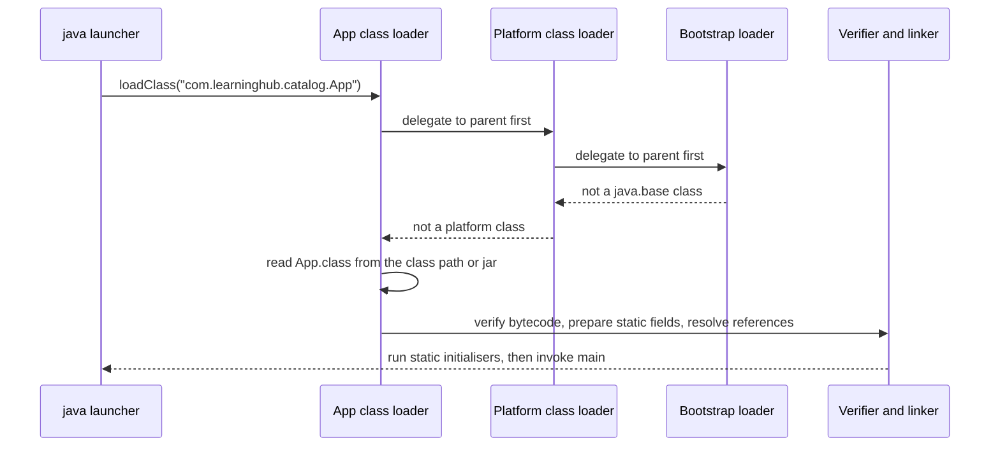

1. **Loading.** Three built-in loaders form a parent chain. The bootstrap loader loads `java.base`; the platform loader loads other JDK modules; the application (system) loader loads your class path. Each loader asks its parent first, so your code cannot replace `java.lang.String`.
2. **Linking.** The verifier checks that the bytecode is type-safe (no jumping into the middle of an instruction, no treating an `int` as a reference). Preparation allocates static fields with default values. Resolution turns symbolic references into direct ones, mostly lazily.
3. **Initialisation.** Static initialisers and static field assignments run once, on first active use, under a lock the JVM manages.
4. **Execution.** HotSpot starts in the interpreter. It counts method calls and loop back-edges. Warm methods are compiled by **C1** (fast compile, light optimisation, collects profiles); hot ones are recompiled by **C2** using those profiles (inlining, escape analysis, loop unrolling). If a speculation turns out wrong, for example a second implementation of an interface appears, the JVM **deoptimises** back to the interpreter and recompiles later.

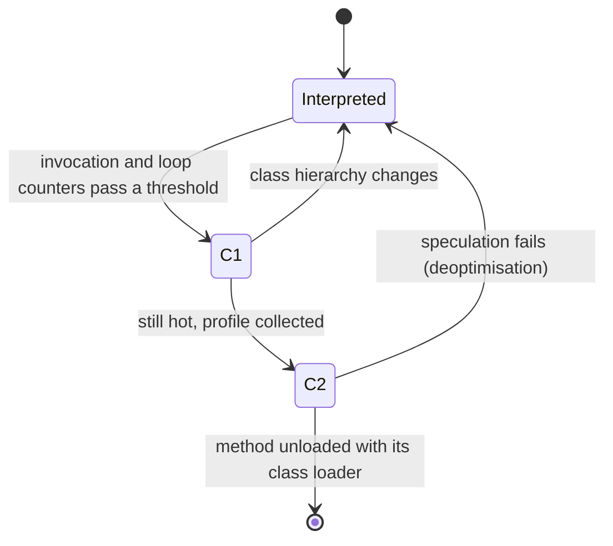

You can watch this happen:

```bash
java -Xlog:class+load:file=classes.txt -jar build/libs/app.jar   # every class the JVM loads
java -XX:+PrintCompilation -jar build/libs/app.jar | head          # methods as the JIT compiles them
jcmd <pid> Compiler.codecache                                      # code cache usage of a running JVM
```

Two consequences for everyday code: the first requests to a fresh JVM are slower (Stage 6 and M3 cover the AOT cache, CDS and native images that reduce this), and microbenchmarks written with `System.nanoTime()` in a loop mostly measure the interpreter and the JIT, not your code. Use JMH (Stage 6).

### 1.10 Build Tools: the Gradle Wrapper and Maven

A build tool resolves dependencies from Maven Central, compiles, runs tests and packages. The two mainstream tools are Gradle and Maven. Both use the same repository format and the same coordinates (`group:artifact:version`).

The starter uses the **Gradle wrapper**: `./gradlew` downloads the exact Gradle version named in `gradle/wrapper/gradle-wrapper.properties`, so every developer and CI run uses the same build tool without installing it.

```text
learn-java/
├── build.gradle.kts            build script (Kotlin DSL)
├── settings.gradle.kts         project name, included builds
├── gradlew, gradlew.bat        wrapper scripts (commit them)
├── gradle/wrapper/
│   ├── gradle-wrapper.jar      tiny bootstrap jar (commit it)
│   └── gradle-wrapper.properties   distributionUrl pins Gradle 9.8.2
├── src/main/java/...           production code
├── src/test/java/...           JUnit tests
└── examples/*.java             single-file programs for Stages 1-3
```

The starter's [`build.gradle.kts`](build.gradle.kts):

```kotlin
plugins {
    java
    application
}

group = "com.learninghub"
version = "1.0.0"

repositories {
    mavenCentral()
}

dependencies {
    testImplementation(platform("org.junit:junit-bom:6.0.0"))
    testImplementation("org.junit.jupiter:junit-jupiter")
    testRuntimeOnly("org.junit.platform:junit-platform-launcher")
}

java {
    toolchain {
        languageVersion = JavaLanguageVersion.of(25)
    }
}

application {
    mainClass = "com.learninghub.catalog.App"
}

tasks.withType<JavaCompile>().configureEach {
    options.release = 25
    options.encoding = "UTF-8"
    // javac's own linter: every warning category on, and any warning fails the build.
    options.compilerArgs.addAll(listOf("-Xlint:all", "-Werror"))
}

tasks.jar {
    archiveFileName = "app.jar"
    manifest {
        attributes("Main-Class" to application.mainClass.get())
    }
}

tasks.test {
    useJUnitPlatform()
    testLogging {
        events("passed", "skipped", "failed")
    }
}
```

| Block | Role | What happens at build time |
| :--- | :--- | :--- |
| `plugins { java; application }` | Applies the Java and application plugins | Adds `compileJava`, `test`, `jar`, `run` and the `src/main/java` convention. |
| `platform("org.junit:junit-bom:6.0.0")` | Bill of materials | Pins every JUnit module to one version, so the next lines need no versions. JUnit 6 keeps the Jupiter API used in JUnit 5. |
| `testImplementation` / `testRuntimeOnly` | Dependency configurations | Test-only dependencies never reach the production jar. |
| `toolchain { languageVersion = 25 }` | JDK selection | Gradle compiles and tests with a JDK 25, even if Gradle itself runs on another JDK. |
| `options.release = 25` | Same as `javac --release 25` | Rejects use of APIs newer than 25. |
| `-Xlint:all -Werror` | Lint | Turns on every javac warning and fails on any of them. This is the starter's lint step in CI. |
| `tasks.jar { ... }` | Packaging | Produces `build/libs/app.jar` with a `Main-Class` manifest entry. No dependencies are bundled because the app has none. |
| `useJUnitPlatform()` | Test engine | Runs JUnit Jupiter tests through the JUnit Platform launcher. |

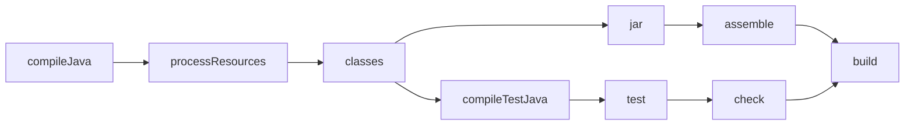

The Maven equivalent of the same project:

```xml
<project xmlns="http://maven.apache.org/POM/4.0.0">
  <modelVersion>4.0.0</modelVersion>
  <groupId>com.learninghub</groupId>
  <artifactId>learn-java</artifactId>
  <version>1.0.0</version>

  <properties>
    <maven.compiler.release>25</maven.compiler.release>
    <project.build.sourceEncoding>UTF-8</project.build.sourceEncoding>
  </properties>

  <dependencyManagement>
    <dependencies>
      <dependency>
        <groupId>org.junit</groupId>
        <artifactId>junit-bom</artifactId>
        <version>6.0.0</version>
        <type>pom</type>
        <scope>import</scope>
      </dependency>
    </dependencies>
  </dependencyManagement>

  <dependencies>
    <dependency>
      <groupId>org.junit.jupiter</groupId>
      <artifactId>junit-jupiter</artifactId>
      <scope>test</scope>
    </dependency>
  </dependencies>
</project>
```

| | Gradle | Maven |
| --- | --- | --- |
| Build file | `build.gradle.kts` (Kotlin) or `build.gradle` (Groovy), code | `pom.xml`, declarative XML |
| Model | Task graph; plugins add tasks | Fixed lifecycle: `validate → compile → test → package → verify → install → deploy` |
| Incremental builds and caching | Built in (up-to-date checks, build cache, configuration cache) | Limited without extensions |
| Wrapper | `./gradlew` | `./mvnw` (create with `mvn wrapper:wrapper`) |
| Everyday commands | `./gradlew build`, `test`, `run`, `dependencies` | `./mvnw verify`, `test`, `package`, `dependency:tree` |
| Typical choice | Android, large multi-project builds, custom logic | Conservative enterprise builds, simple libraries |

### 1.11 Line-by-Line Breakdown of the Starter Project

The starter is a read-only book catalogue served over HTTP with nothing but the JDK. Build and run it:

```bash
./gradlew build            # compile with -Xlint:all -Werror, run 36 tests, package build/libs/app.jar
./gradlew run              # or: java -jar build/libs/app.jar
# catalog listening on http://0.0.0.0:8080 (Java 25.0.5+8-LTS)

curl -s localhost:8080/health
# {"status":"UP"}
curl -s localhost:8080/books/978-1-00-000003-0
# {"isbn":"9781000000030","title":"Tides of the Northern Sea","author":"Ada Okafor","year":2019,"genre":"HISTORY","pages":530}
curl -s localhost:8080/stats
# {"books":5,"byGenre":{"PROGRAMMING":2,"SCIENCE":1,"HISTORY":1,"FICTION":1},"pages":{...}}
curl -s -o /dev/null -w '%{http_code}\n' localhost:8080/books/123
# 400
```

```text
src/main/java/com/learninghub/catalog/
├── App.java                     entry point: PORT, bind, shutdown hook
├── model/   Isbn, Book, Genre   value types (records, enum)          Stage 1-3
├── store/   Repository, InMemoryRepository   generic storage port    Stage 2-3
├── service/ CatalogService, LookupResult, SampleData   rules, sealed results  Stage 2-3
└── http/    CatalogServer, Json, Response   JDK HttpServer, JSON writer    Stage 3-5
```

The entry point, [`App.java`](src/main/java/com/learninghub/catalog/App.java):

```java
package com.learninghub.catalog;

import com.learninghub.catalog.http.CatalogServer;
import com.learninghub.catalog.service.CatalogService;
import com.learninghub.catalog.service.SampleData;

import java.io.IOException;
import java.net.InetSocketAddress;

/** Entry point: reads PORT, binds 0.0.0.0 and serves the catalogue until the JVM stops. */
public final class App {

    private App() {
    }

    public static void main(String[] args) throws IOException {
        int port = parsePort(System.getenv("PORT"));
        var catalog = new CatalogService(SampleData.repository());
        var server = new CatalogServer(new InetSocketAddress("0.0.0.0", port), catalog);
        server.start();
        // Stop the server cleanly on SIGTERM (docker stop) or Ctrl+C.
        Runtime.getRuntime().addShutdownHook(Thread.ofPlatform().name("shutdown").unstarted(server::close));
        System.out.printf("catalog listening on http://0.0.0.0:%d (Java %s)%n", server.port(), Runtime.version());
    }

    static int parsePort(String raw) {
        if (raw == null || raw.isBlank()) {
            return 8080;
        }
        try {
            int port = Integer.parseInt(raw.strip());
            if (port < 0 || port > 65_535) {
                throw new IllegalArgumentException("PORT out of range: " + raw);
            }
            return port;
        } catch (NumberFormatException e) {
            throw new IllegalArgumentException("PORT is not a number: " + raw, e);
        }
    }
}
```

| Line / API | Role | What happens at runtime |
| :--- | :--- | :--- |
| `public final class App` with a `private` constructor | Utility class | Nobody can instantiate or subclass it; it only holds `main`. |
| `public static void main(String[] args) throws IOException` | Classic entry point | Named in the jar manifest. `IOException` from binding the port propagates and the JVM exits with a stack trace and status 1. |
| `System.getenv("PORT")` | Configuration from the environment | Returns `null` when unset. Containers and platforms set `PORT`. |
| `parsePort` | Validation | Wraps `NumberFormatException` in an `IllegalArgumentException` with a clear message and keeps the original as the cause. Package-private so `AppTest` can call it. |
| `new InetSocketAddress("0.0.0.0", port)` | Bind address | Listens on every interface. Binding `localhost` inside a container makes the port unreachable from outside. |
| `SampleData.repository()` | Composition root | `main` wires concrete classes together; the rest of the code depends on interfaces. |
| `server.start()` | Starts the JDK `HttpServer` | Returns immediately. The server's dispatcher thread is a non-daemon thread, so the JVM keeps running after `main` returns. |
| `addShutdownHook(Thread.ofPlatform()...unstarted(server::close))` | Graceful stop | On SIGTERM or Ctrl+C the JVM runs the hook, which stops the server and closes its virtual-thread executor. |
| `printf("%d ... %s%n")` | Formatted output | `%n` is the platform line separator. `Runtime.version()` prints the full build string. |

The test for it, [`AppTest.java`](src/test/java/com/learninghub/catalog/AppTest.java), checks the default and the error paths:

```java
@Test
void portIsParsedAndValidated() {
    assertEquals(9090, App.parsePort("9090"));
    assertThrows(IllegalArgumentException.class, () -> App.parsePort("http"));
    assertThrows(IllegalArgumentException.class, () -> App.parsePort("70000"));
}
```

### 1.12 Pitfalls

| Pitfall | Symptom | Fix |
| --- | --- | --- |
| Two JDKs on the `PATH` | `UnsupportedClassVersionError: ... class file version 69.0, this version of the Java Runtime only recognizes class file versions up to 65.0` | Run with the same or newer JDK than you compiled with. Check `java -version`, `javac -version` and `JAVA_HOME`. |
| Public class name differs from the file name | `error: class Greeter is public, should be declared in a file named Greeter.java` | Rename the file or the class. |
| Running a class without its package name | `Error: Could not find or load main class Main` / `Caused by: java.lang.NoClassDefFoundError: Main (wrong name: com/example/greeter/Main)` | `java -cp out com.example.greeter.Main`, run from the directory above the package root. |
| Comparing strings with `==` | Works in tests with literals, fails with user input | `a.equals(b)`, or `Objects.equals(a, b)` when either may be `null`. |
| `int` overflow in intermediate results | Negative totals, wrong durations (`365 * 24 * 60 * 60 * 1000` is `1471228928`) | Make the first operand `long` (`365L * ...`) or use `Math.multiplyExact`. |
| `double` for money | `0.1 + 0.2` prints `0.30000000000000004` | `long` cents or `new BigDecimal("0.10")`. |
| `new BigDecimal(0.1)` | Value is `0.1000000000000000055511...` | Use the `String` constructor or `BigDecimal.valueOf(double)`. |
| Unboxing `null` | `NullPointerException: Cannot invoke "java.lang.Integer.intValue()" because the return value of "java.util.Map.get(Object)" is null` | `map.getOrDefault(key, 0)`, or keep the boxed type and check for `null`. |
| `==` on boxed numbers | `true` for 127, `false` for 128 | `equals`, or compare unboxed values. |
| Default-locale case conversion | `"TITLE".toLowerCase()` returns `"tıtle"` on a Turkish locale | `toLowerCase(Locale.ROOT)` for identifiers and keys. |
| Fall-through in old-style `switch` | Several branches run | Use the arrow form `case X ->`. |
| Timing code with `System.nanoTime()` loops | Numbers change between runs and with loop order | Use JMH; warm-up and dead-code elimination distort hand-written benchmarks. |

### 1.13 Best Practices

- **Pin the toolchain**: commit the Gradle or Maven wrapper and set a toolchain or `release`, so every machine builds with the same versions.
- **Compile with `--release`**: it checks API usage against the target version, which `-source`/`-target` do not.
- **Turn on `-Xlint:all -Werror` early**: warnings are cheap to fix one at a time and expensive to fix by the thousand.
- **Use `jshell` to check behaviour**: ten seconds in the REPL beats a wrong assumption in production.
- **Prefer `int` and `long` unless you need objects**: primitives avoid allocation and `null`.
- **Use `Math.*Exact` where overflow is a bug**: it turns silent wrap-around into an exception you can see.
- **Pass `Locale.ROOT` to case conversion of machine-readable text**: the default locale varies by host.
- **Use `var` for obvious types only**: the reader should still know the type without an IDE.
- **Bind `0.0.0.0` and read the port from the environment in services**: it is what containers and platforms expect.
- **Keep `main` thin**: parse configuration, wire objects, start; put logic in classes you can test.

### 1.14 Hands-on Exercise

Add a `GET /books/newest?limit=N` route to the starter that returns the `N` newest books, newest first.

1. `CatalogService.newest(int limit)` already exists; read it and its test `newestSortsByYearDescending` in [`CatalogServiceTest.java`](src/test/java/com/learninghub/catalog/service/CatalogServiceTest.java).
2. In [`CatalogServer.route`](src/main/java/com/learninghub/catalog/http/CatalogServer.java), add a `case "/books/newest"` before the `default` branch. Read `limit` with the existing `query(rawQuery)` helper and default it to `3`.
3. Return `400` with an error body when `limit` is not a number or is negative.
4. Add a test to [`CatalogServerTest.java`](src/test/java/com/learninghub/catalog/http/CatalogServerTest.java).

Expected output:

```bash
curl -s 'localhost:8080/books/newest?limit=2'
# [{"isbn":"9781000000054","title":"The Lighthouse Ledger",...,"year":2025,...},
#  {"isbn":"9781000000016","title":"Bytecode by Candlelight",...,"year":2024,...}]
curl -s -o /dev/null -w '%{http_code}\n' 'localhost:8080/books/newest?limit=x'
# 400
```

Why does `/books/newest` need its own constant `case`? A `switch` reaches `default` only when no constant matches, and the `default` branch treats everything after `/books/` as an ISBN, so without the new case every request would return `400`.

[Back to top ⤴️](#-table-of-contents)

---

## 2. Stage 2: Methods, Collections, Streams & Packages

This stage covers how Java code is organised into methods and packages and how it holds and transforms data: arrays, the collections framework, lambdas and streams. Prerequisite: Stage 1. Afterwards you can write data-processing code in loop or stream style, choose the right collection for the job, and structure a code base into packages and modules with deliberate visibility.

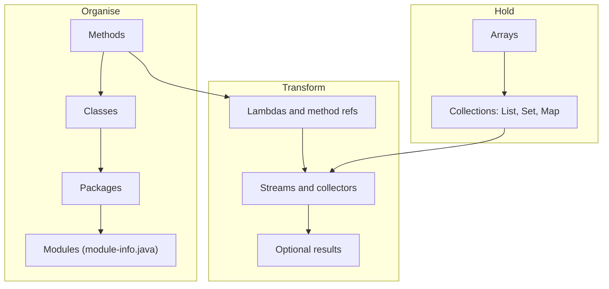

### 2.1 Methods: Parameters, Overloading, Varargs and Pass-by-Value

A method has a signature (name plus parameter types), a return type, modifiers and a body. Java resolves which overload to call at **compile time** from the static types of the arguments.

```java
import java.util.Arrays;
import java.util.List;

public class Methods {

    static int sum(int a, int b) { return a + b; }
    static long sum(long a, long b) { return a + b; }
    static double sum(double... values) {          // varargs: values is a double[]
        return Arrays.stream(values).sum();
    }

    static void describe(Object o) { System.out.println("Object: " + o); }
    static void describe(String s) { System.out.println("String: " + s); }

    // Java passes everything by value. For objects, the value is the reference.
    static void reassign(StringBuilder sb) { sb = new StringBuilder("new"); }
    static void mutate(StringBuilder sb) { sb.append(" changed"); }

    public static void main(String[] args) {
        System.out.println(sum(1, 2));          // 3     int version
        System.out.println(sum(1L, 2));         // 3     long version (2 widens)
        System.out.println(sum(1.5, 2.5, 3.0)); // 7.0   varargs
        System.out.println(sum());              // 0.0   varargs with zero arguments

        Object text = "hi";
        describe(text);                         // Object: hi  (static type decides)
        describe("hi");                         // String: hi

        var sb = new StringBuilder("old");
        reassign(sb);
        System.out.println(sb);                 // old          caller's variable untouched
        mutate(sb);
        System.out.println(sb);                 // old changed  the shared object changed

        List<Integer> xs = new java.util.ArrayList<>(List.of(10, 20, 30));
        xs.remove(1);                           // remove(int index): removes 20
        xs.remove(Integer.valueOf(10));         // remove(Object): removes 10
        System.out.println(xs);                 // [30]
    }
}
```

| Rule | Consequence |
| --- | --- |
| Overloads are chosen at compile time by static type | `describe(text)` picks `Object` even though `text` holds a `String`. Overriding (Stage 3) is chosen at run time. |
| Resolution phases: exact or widening, then boxing, then varargs | `sum(1, 2)` never reaches the varargs overload while a fixed-arity one fits. |
| Everything is passed by value | Reassigning a parameter has no effect on the caller; mutating the object it points to does. |
| `List.remove(int)` vs `remove(Object)` | With a `List<Integer>`, `remove(1)` removes by index. Box explicitly to remove by value. |
| Varargs create an array per call | Fine for convenience APIs; avoid on hot paths. |

Prefer a few clearly named methods over many overloads that differ only by numeric type; overloads with `int`, `long`, `Integer` and `Object` interact through widening and boxing in ways readers rarely predict.

### 2.2 Arrays and the `Arrays` Utility Class

Arrays are fixed-length, typed, zero-indexed objects. They know their length (`a.length`) and check bounds on every access.

```java
import java.util.Arrays;

public class ArraysDemo {
    public static void main(String[] args) {
        int[] scores = {72, 95, 88, 61};
        int[][] grid = new int[3][4];            // 3 rows of 4 zeros
        String[] names = new String[2];          // [null, null]

        Arrays.sort(scores);                     // dual-pivot quicksort for primitives
        System.out.println(Arrays.toString(scores));          // [61, 72, 88, 95]
        System.out.println(Arrays.binarySearch(scores, 88));  // 2 (array must be sorted)
        System.out.println(Arrays.deepToString(grid));        // [[0, 0, 0, 0], ...]
        System.out.println(Arrays.toString(names));           // [null, null]

        int[] copy = Arrays.copyOf(scores, 6);   // pads with zeros
        int[] slice = Arrays.copyOfRange(scores, 1, 3);       // [72, 88]
        System.out.println(Arrays.equals(scores, Arrays.copyOf(scores, 4))); // true
        System.out.println(scores.equals(Arrays.copyOf(scores, 4)));         // false: identity
        System.out.println(copy.length + " " + slice.length);

        Arrays.fill(names, "?");
        System.out.println(String.join(",", names));          // ?,?

        // Arrays are covariant, which the compiler cannot fully check:
        Object[] objects = new String[1];
        try {
            objects[0] = 42;
        } catch (ArrayStoreException e) {
            System.out.println("ArrayStoreException: " + e.getMessage()); // java.lang.Integer
        }
    }
}
```

| Need | Use |
| --- | --- |
| Print | `Arrays.toString`, `Arrays.deepToString` for nested arrays |
| Compare content | `Arrays.equals`, `Arrays.deepEquals`; `array.equals` compares identity |
| Hash content | `Arrays.hashCode` |
| Sort / search | `Arrays.sort` (stable TimSort for objects), `Arrays.binarySearch` |
| Grow or slice | `Arrays.copyOf`, `Arrays.copyOfRange` |
| Stream | `Arrays.stream(int[])` gives an `IntStream` with no boxing |
| Wrap as a list | `Arrays.asList` (fixed size, writes through to the array) or `List.of` (copy, immutable) |

In application code, prefer `List` over arrays: lists grow, work with generics and have useful `equals`/`toString`. Arrays remain the right choice for primitive-heavy numeric code, fixed-size buffers and APIs such as `byte[]` I/O.

### 2.3 The Collections Framework: `List`, `Set`, `Map` and Sequenced Collections

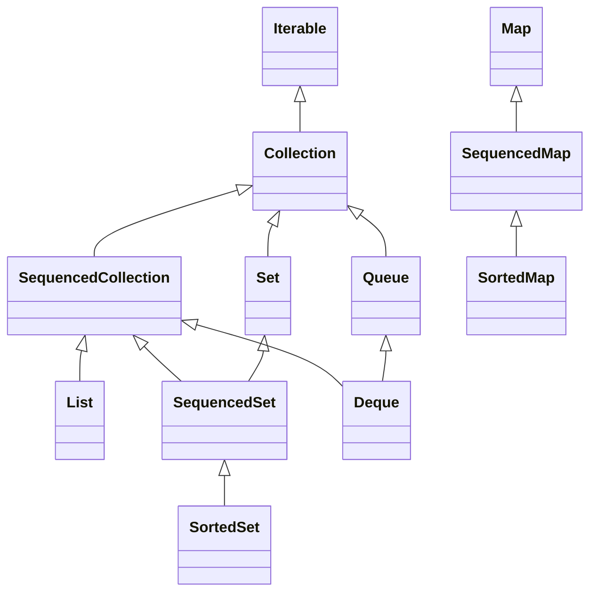

| Interface | Default implementation | Others | Ordering | `null` allowed | Typical cost |
| --- | --- | --- | --- | --- | --- |
| `List` | `ArrayList` | `LinkedList` (rarely better), `CopyOnWriteArrayList` | Insertion / index | Yes | get O(1), add at end amortised O(1), insert in middle O(n) |
| `Set` | `HashSet` | `LinkedHashSet` (insertion order), `TreeSet` (sorted), `EnumSet` | None / insertion / sorted | `HashSet` yes, `TreeSet` no | contains O(1) hash, O(log n) tree |
| `Map` | `HashMap` | `LinkedHashMap`, `TreeMap`, `EnumMap`, `ConcurrentHashMap` | None / insertion or access / sorted | `HashMap` yes, `TreeMap` keys no, `ConcurrentHashMap` no | get O(1) hash, O(log n) tree |
| `Deque` | `ArrayDeque` | `LinkedList`, `ConcurrentLinkedDeque` | Both ends | No (`ArrayDeque`) | push/pop both ends O(1) |
| `Queue` (priority) | `PriorityQueue` | `PriorityBlockingQueue` | Heap order | No | offer/poll O(log n) |

**Sequenced collections** (Java 21) gave every ordered collection the same first/last API. Before 21, getting the last element of a `LinkedHashSet` required iterating the whole set.

```java
import java.util.ArrayList;
import java.util.LinkedHashMap;
import java.util.LinkedHashSet;
import java.util.List;
import java.util.SequencedMap;

public class Sequenced {
    public static void main(String[] args) {
        List<String> list = new ArrayList<>(List.of("b", "c"));
        list.addFirst("a");
        System.out.println(list.getFirst() + " " + list.getLast()); // a c
        System.out.println(list.reversed());                         // [c, b, a] (a view)

        var set = new LinkedHashSet<>(List.of(3, 1, 2));
        System.out.println(set.getLast());                           // 2

        SequencedMap<String, Integer> recent = new LinkedHashMap<>();
        recent.put("x", 1);
        recent.put("y", 2);
        recent.putFirst("w", 0);
        System.out.println(recent.firstEntry() + " " + recent.lastEntry()); // w=0 y=2
        System.out.println(recent.pollFirstEntry());                 // w=0, and removes it
        System.out.println(recent.reversed());                       // {y=2, x=1}
    }
}
```

Choose by the operation you do most: membership tests mean a `Set`, lookup by key means a `Map`, both-end access means `ArrayDeque`. Use `java.util.Stack` and `Vector` only in legacy code; they synchronise every call and `Deque` replaces them.

### 2.4 `equals`, `hashCode` and How `HashMap` Works

Hash-based collections rely on a contract between two methods:

1. `equals` is reflexive, symmetric, transitive and consistent, and `x.equals(null)` is `false`.
2. Equal objects **must** have equal hash codes. Unequal objects may share a hash code; that only costs speed.
3. A key's `equals`/`hashCode` must not change while it is in a map or set.

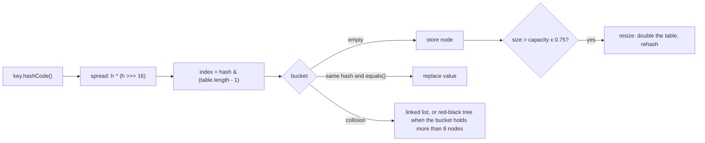

What breaks when the contract does:

```java
import java.util.HashSet;
import java.util.Set;

public class HashContract {

    static final class BadPoint {                 // equals without hashCode
        final int x, y;
        BadPoint(int x, int y) { this.x = x; this.y = y; }
        @Override public boolean equals(Object o) {
            return o instanceof BadPoint p && p.x == x && p.y == y;
        }
    }

    static final class MutableKey {               // hash changes after insertion
        int id;
        MutableKey(int id) { this.id = id; }
        @Override public boolean equals(Object o) { return o instanceof MutableKey k && k.id == id; }
        @Override public int hashCode() { return Integer.hashCode(id); }
    }

    record Point(int x, int y) {}                 // records generate both correctly

    public static void main(String[] args) {
        Set<BadPoint> bad = new HashSet<>();
        bad.add(new BadPoint(1, 2));
        System.out.println(bad.contains(new BadPoint(1, 2)));  // false (almost always)

        var key = new MutableKey(1);
        Set<MutableKey> keys = new HashSet<>();
        keys.add(key);
        key.id = 2;
        System.out.println(keys.contains(key));                // false: wrong bucket now
        System.out.println(keys.size());                       // 1, and the entry is stuck

        Set<Point> good = new HashSet<>();
        good.add(new Point(1, 2));
        System.out.println(good.contains(new Point(1, 2)));    // true
    }
}
```

| Implementation detail (HotSpot `HashMap`) | Why it matters |
| --- | --- |
| Table length is a power of two; index is `hash & (n - 1)` | `HashMap` spreads high bits into low bits so poor hash functions still distribute. |
| Default capacity 16, load factor 0.75 | 13th insertion triggers the first resize. Pre-size with `HashMap.newHashMap(expected)` (Java 19) for large known sizes. |
| A bucket with more than 8 entries becomes a red-black tree (when the table has at least 64 slots) | Worst-case lookup drops from O(n) to O(log n), which limits hash-flooding attacks on keys that implement `Comparable`. |
| Iteration order is unspecified and changes with capacity | Never let output or tests depend on `HashMap` order; use `LinkedHashMap` or `TreeMap`. |

Write `equals` and `hashCode` by hand only when you must. Records generate both from all components. For classes, generate them with your IDE from the same fields, or use `Objects.equals` and `Objects.hash`.

### 2.5 Immutable vs Unmodifiable Collections

Java has several "read-only" flavours that behave differently:

```java
import java.util.ArrayList;
import java.util.Arrays;
import java.util.Collections;
import java.util.List;

public class ReadOnly {
    public static void main(String[] args) {
        List<String> source = new ArrayList<>(List.of("a", "b"));

        List<String> view = Collections.unmodifiableList(source);  // read-only view
        List<String> copy = List.copyOf(source);                   // immutable snapshot
        List<String> fixed = Arrays.asList("x", "y");              // fixed-size, settable

        source.add("c");
        System.out.println(view);   // [a, b, c]  the view sees later changes
        System.out.println(copy);   // [a, b]     the copy does not

        fixed.set(0, "z");          // allowed
        System.out.println(fixed);  // [z, y]
        try {
            fixed.add("w");
        } catch (UnsupportedOperationException e) {
            System.out.println("asList cannot grow");
        }
        try {
            List.of("a", null);
        } catch (NullPointerException e) {
            System.out.println("List.of rejects null");
        }
        try {
            List.of("a").contains(null);
        } catch (NullPointerException e) {
            System.out.println("even contains(null) throws on List.of");
        }
    }
}
```

| Factory | Mutable? | Reflects source changes | `null` elements | Notes |
| --- | --- | --- | --- | --- |
| `new ArrayList<>(...)` | Yes | No (copy) | Yes | The default for building lists. |
| `List.of`, `Set.of`, `Map.of` (Java 9) | No | n/a | No (NPE) | `Set.of` and `Map.of` reject duplicates with `IllegalArgumentException`. Iteration order of `Set.of`/`Map.of` is deliberately randomised per JVM run. |
| `List.copyOf` (Java 10) | No | No | No | Returns the argument itself if it is already an immutable list. |
| `Collections.unmodifiableList` | No through the view | Yes | Yes | Protects against callers, not against the owner. |
| `Arrays.asList` | `set` yes, `add`/`remove` no | Writes through to the array | Yes | Backed by the array you pass. |
| `stream.toList()` (Java 16) | No | No | Yes | Prefer it to `collect(Collectors.toList())`, whose mutability is unspecified. |

A record or class that receives a list should store `List.copyOf(list)`. The starter does this implicitly by returning `List.copyOf` from [`InMemoryRepository.findAll`](src/main/java/com/learninghub/catalog/store/InMemoryRepository.java), and `InMemoryRepositoryTest.findAllReturnsAnUnmodifiableSnapshot` proves the snapshot neither changes nor accepts writes.

### 2.6 Lambdas, Method References and Functional Interfaces

A lambda is a compact implementation of a **functional interface**: an interface with exactly one abstract method. The compiler infers parameter types from the target type.

```java
import java.util.ArrayList;
import java.util.Comparator;
import java.util.List;
import java.util.function.BiFunction;
import java.util.function.Function;
import java.util.function.Predicate;
import java.util.function.Supplier;
import java.util.function.UnaryOperator;

public class Lambdas {

    @FunctionalInterface
    interface Discount {
        double apply(double price);
        default Discount then(Discount next) { return p -> next.apply(apply(p)); }
    }

    public static void main(String[] args) {
        Predicate<String> isEmpty = String::isEmpty;              // unbound instance method ref
        Function<String, Integer> length = String::length;
        Supplier<List<String>> newList = ArrayList::new;          // constructor ref
        BiFunction<Integer, Integer, Integer> add = Integer::sum; // static method ref
        UnaryOperator<String> shout = s -> s.toUpperCase() + "!";

        String prefix = "id-";
        Function<Integer, String> label = n -> prefix + n;        // captures an effectively final local
        // prefix = "x";   // compile error: local variables referenced from a lambda must be final or effectively final

        Discount tenOff = p -> p - 10;
        Discount halve = p -> p / 2;
        System.out.println(tenOff.then(halve).apply(100));        // 45.0

        List<String> names = newList.get();
        names.addAll(List.of("lin", "Ada", "bo"));
        names.sort(Comparator.comparing(String::length).thenComparing(Comparator.naturalOrder()));
        System.out.println(names);                                 // [bo, Ada, lin]
        names.removeIf(isEmpty.negate().and(s -> s.length() < 3));
        System.out.println(names + " " + length.apply("four") + " " + add.apply(2, 3)
                + " " + shout.apply("hi") + " " + label.apply(7));
    }
}
```

| Interface | Method | Shape | Example |
| --- | --- | --- | --- |
| `Supplier<T>` | `get()` | `() -> T` | `ArrayList::new` |
| `Consumer<T>` | `accept(T)` | `T -> void` | `System.out::println` |
| `Function<T, R>` | `apply(T)` | `T -> R` | `String::length` |
| `BiFunction<T, U, R>` | `apply(T, U)` | `(T, U) -> R` | `Integer::sum` |
| `Predicate<T>` | `test(T)` | `T -> boolean` | `String::isBlank` |
| `UnaryOperator<T>` / `BinaryOperator<T>` | `apply` | `T -> T`, `(T, T) -> T` | `String::strip`, `Math::max` |
| `IntFunction`, `ToIntFunction`, `IntPredicate`, ... | | primitive specialisations | avoid boxing on hot paths |
| `Runnable`, `Callable<V>` | `run()`, `call()` | tasks | executors (Stage 4) |

Lambdas are not anonymous inner classes. The compiler emits an `invokedynamic` call site, and the JVM creates the implementing class at first use through `LambdaMetafactory`. A non-capturing lambda is typically a single shared instance. Inside a lambda, `this` means the enclosing instance, not the lambda.

Checked exceptions do not mix well with `java.util.function`: `Function.apply` declares no checked exceptions, so `paths.stream().map(Files::readString)` does not compile (`unreported exception java.io.IOException`). Either handle the exception inside the lambda, wrap it in `UncheckedIOException`, or use a loop.

### 2.7 Streams: Pipelines, Collectors and Gatherers

A stream is a lazy pipeline: a source, zero or more intermediate operations, and one terminal operation. Nothing runs until the terminal operation pulls elements through, one at a time.

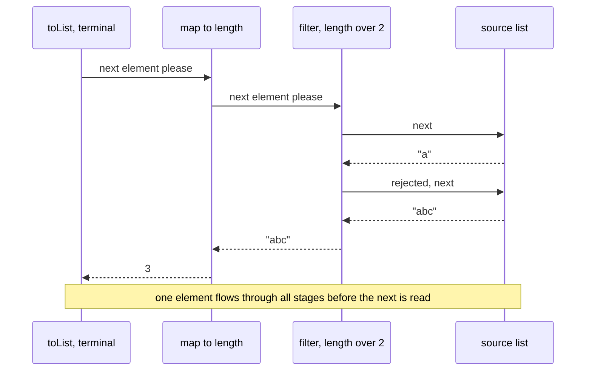

The starter's [`CatalogService`](src/main/java/com/learninghub/catalog/service/CatalogService.java) uses streams for every query:

```java
/** Case-insensitive substring match on the author, using a fixed locale. */
public List<Book> byAuthor(String query) {
    String needle = query.strip().toLowerCase(Locale.ROOT);
    return books.findAll().stream()
            .filter(book -> book.author().toLowerCase(Locale.ROOT).contains(needle))
            .toList();
}

/** Number of books per genre. EnumMap keeps keys in declaration order. */
public Map<Genre, Long> countByGenre() {
    return books.findAll().stream()
            .collect(Collectors.groupingBy(
                    Book::genre,
                    () -> new EnumMap<>(Genre.class),
                    Collectors.counting()));
}

public IntSummaryStatistics pageStatistics() {
    return books.findAll().stream().mapToInt(Book::pages).summaryStatistics();
}

/** The {@code limit} newest books, newest first, ties broken by title. */
public List<Book> newest(int limit) {
    if (limit < 0) {
        throw new IllegalArgumentException("limit must not be negative: " + limit);
    }
    return books.findAll().stream()
            .sorted(Comparator.comparingInt(Book::year).reversed().thenComparing(Book::title))
            .limit(limit)
            .toList();
}
```

| Line / API | Role | What happens at runtime |
| :--- | :--- | :--- |
| `.filter(...)` | Stateless intermediate op | Passes each element on or drops it. |
| `.toList()` | Terminal op | Collects into an unmodifiable list (Java 16+). |
| `Collectors.groupingBy(classifier, mapFactory, downstream)` | Grouping collector | Builds an `EnumMap<Genre, Long>`; `counting()` is the downstream collector applied to each group. |
| `mapToInt(Book::pages)` | Primitive stream | Avoids boxing every page count. |
| `summaryStatistics()` | Terminal op | One pass computes count, min, max, sum and average. |
| `sorted(...)` | Stateful intermediate op | Must see every element before emitting the first; costs O(n log n) and memory. |
| `.limit(limit)` | Short-circuiting op | Stops pulling once enough elements passed. |

More collectors and operations you will use weekly:

```java
import java.util.List;
import java.util.Map;
import java.util.function.Function;
import java.util.stream.Collectors;
import java.util.stream.Gatherers;
import java.util.stream.IntStream;
import java.util.stream.Stream;

public class StreamsTour {
    record Order(String customer, String item, int cents) {}

    public static void main(String[] args) {
        var orders = List.of(
                new Order("ada", "book", 1200), new Order("lin", "pen", 300),
                new Order("ada", "pen", 300), new Order("bo", "book", 1200));

        Map<String, Integer> spend = orders.stream()
                .collect(Collectors.groupingBy(Order::customer, Collectors.summingInt(Order::cents)));
        Map<Boolean, List<String>> bigSmall = orders.stream()
                .collect(Collectors.partitioningBy(o -> o.cents() >= 1000,
                        Collectors.mapping(Order::item, Collectors.toList())));
        Map<String, Order> firstByCustomer = orders.stream()
                .collect(Collectors.toMap(Order::customer, Function.identity(), (first, later) -> first));
        String customers = orders.stream().map(Order::customer).distinct().sorted()
                .collect(Collectors.joining(", ", "[", "]"));
        List<String> items = Stream.of(List.of("a", "b"), List.of("c")).flatMap(List::stream).toList();
        int total = orders.stream().mapToInt(Order::cents).sum();
        boolean anyFree = orders.stream().anyMatch(o -> o.cents() == 0);

        // Gatherers (Java 24): custom intermediate operations
        List<List<Integer>> windows = IntStream.rangeClosed(1, 7).boxed()
                .gather(Gatherers.windowFixed(3)).toList();       // [[1,2,3],[4,5,6],[7]]
        List<Integer> running = Stream.of(1, 2, 3, 4)
                .gather(Gatherers.scan(() -> 0, Integer::sum)).toList(); // [1, 3, 6, 10]

        System.out.println(spend + "\n" + bigSmall + "\n" + firstByCustomer.keySet() + "\n" + customers
                + "\n" + items + " " + total + " " + anyFree + "\n" + windows + " " + running);
    }
}
```

| Loop or stream? | Prefer a loop | Prefer a stream |
| --- | --- | --- |
| Logic | Early exits with complex conditions, several accumulators updated together | Filter, map, group, collect |
| Checked exceptions | Thrown from the body | Not thrown |
| Mutation | Updating local state is natural | Avoid side effects in lambdas |
| Debugging | Step through in a debugger | `peek` exists, but breakpoints in lambdas are fiddlier |
| Parallelism | Manual | `parallelStream()` only for CPU-bound work on large data with no shared state, and measure first |

[`examples/WordFrequency.java`](examples/WordFrequency.java) implements the same count both ways and checks that the results agree:

```java
/** Imperative version: a HashMap and Map.merge. */
static Map<String, Long> countLoop(List<String> words) {
    Map<String, Long> counts = new HashMap<>();
    for (String w : words) {
        counts.merge(w, 1L, Long::sum);
    }
    return counts;
}

/** Declarative version: groupingBy + counting, collected into a TreeMap (sorted keys). */
static Map<String, Long> countStream(List<String> words) {
    return words.stream()
            .collect(Collectors.groupingBy(w -> w, TreeMap::new, Collectors.counting()));
}
```

```bash
java examples/WordFrequency.java
# words: 16, distinct: 11
# the = 4
# dog = 2
# fox = 2
```

### 2.8 `Optional` Done Right

`Optional<T>` is a return type that says "there may be no result". It forces callers to decide what absence means instead of discovering `null` at run time.

```java
import java.util.Map;
import java.util.Optional;

public class Optionals {
    static final Map<String, String> EMAILS = Map.of("ada", "ada@example.com");

    static Optional<String> email(String user) {
        return Optional.ofNullable(EMAILS.get(user));
    }

    static String expensiveDefault() {
        System.out.println("computing default...");
        return "nobody@example.com";
    }

    public static void main(String[] args) {
        System.out.println(email("ada").map(String::toUpperCase).orElse("?"));   // ADA@EXAMPLE.COM
        System.out.println(email("bo").orElse(expensiveDefault()));              // default is computed
        System.out.println(email("ada").orElse(expensiveDefault()));             // ...and computed even here
        System.out.println(email("ada").orElseGet(Optionals::expensiveDefault)); // lazy: not computed
        email("bo").ifPresentOrElse(System.out::println, () -> System.out.println("no email"));
        String domain = email("ada").filter(e -> e.contains("@"))
                .map(e -> e.substring(e.indexOf('@') + 1)).orElseThrow();
        System.out.println(domain);                                              // example.com
    }
}
```

The starter's `CatalogService.lookup` converts an `Optional` into a richer sealed result:

```java
return books.findById(isbn)
        .<LookupResult>map(LookupResult.Found::new)
        .orElseGet(() -> new LookupResult.NotFound(isbn));
```

The explicit type witness `<LookupResult>` widens the `Optional<Found>` to `Optional<LookupResult>`, so `orElseGet` may return a `NotFound`.

| Do | Don't |
| --- | --- |
| Return `Optional` from lookups that can miss | Use `Optional` for fields, method parameters or collection elements |
| `map`, `filter`, `orElseGet`, `orElseThrow` | Call `get()` without checking; it throws `NoSuchElementException` (prefer `orElseThrow()`, which says so in its name) |
| Return an empty collection instead of `Optional<List<T>>` | Return `null` from a method declared to return `Optional` |
| Use `OptionalInt` etc. for primitives | Wrap values that can never be absent |

### 2.9 Packages, Access Modifiers and the Module System

A **package** is a namespace and a unit of access control. Name packages by reversed domain (`com.learninghub.catalog`) and lay out directories to match.

| Modifier | Same class | Same package | Subclass in another package | Everywhere |
| --- | --- | --- | --- | --- |
| `private` | ✔ | | | |
| (none) package-private | ✔ | ✔ | | |
| `protected` | ✔ | ✔ | ✔ (through inheritance) | |
| `public` | ✔ | ✔ | ✔ | ✔ (if the module exports the package) |

The starter uses package-private visibility deliberately: `CatalogServer.route` and `CatalogServer.query` are package-private so tests in the same package can call them, while other packages cannot.

**Modules** (Java 9, JPMS) group packages and state dependencies and exports explicitly in `module-info.java`:

```java
// src/main/java/module-info.java (if the starter were a named module)
module com.learninghub.catalog {
    requires jdk.httpserver;                       // com.sun.net.httpserver lives here
    exports com.learninghub.catalog.model;         // public API for other modules
    exports com.learninghub.catalog.service;
    // http and store stay internal: public classes there are invisible to other modules
}
```

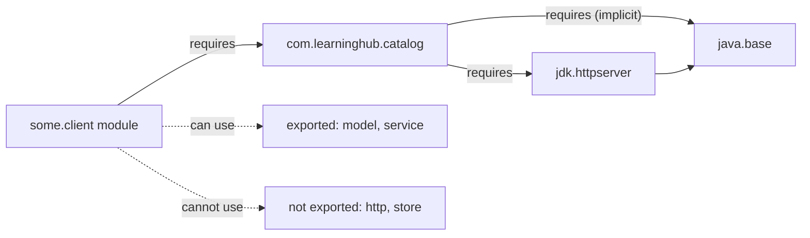

| Directive | Meaning |
| --- | --- |
| `requires M` | This module reads `M`; compile and run fail if `M` is missing. |
| `requires transitive M` | Modules that read this one also read `M` (use when `M`'s types appear in your API). |
| `requires static M` | Needed at compile time, optional at run time (annotations, optional integrations). |
| `exports p` | Public types in package `p` are accessible to other modules. |
| `exports p to M` | Qualified export, only to `M`. |
| `opens p` | Allows deep reflection into `p` at run time (needed by frameworks that read private fields). |
| `uses S` / `provides S with Impl` | Service loading through `ServiceLoader`. |

Most applications still run on the class path (the "unnamed module"), which reads every module and exports everything. Modules pay off for libraries that want to hide internals, for `jlink` runtimes (Stage 6), and for very large code bases that need enforced boundaries. Even on the class path, the JDK's own modules are strongly encapsulated: code that calls JDK internals such as `sun.nio.ch` fails with `IllegalAccessError` or `InaccessibleObjectException` unless you add `--add-opens`/`--add-exports`, which is a migration smell.

Since Java 25, `import module java.base;` imports all packages a module exports in one line (see V.3). It is handy in scripts and tests; in production code, explicit imports document dependencies better.

### 2.10 Walkthrough: the Generic Repository in the Starter

[`Repository`](src/main/java/com/learninghub/catalog/store/Repository.java) is the storage port the service depends on:

```java
public interface Repository<T, ID> {

    Optional<T> findById(ID id);

    List<T> findAll();

    /** Inserts or replaces the entity and returns it. */
    T save(T entity);

    boolean deleteById(ID id);

    int count();

    /** Default methods let an interface grow without breaking implementers. */
    default boolean existsById(ID id) {
        return findById(id).isPresent();
    }
}
```

[`SampleData.repository()`](src/main/java/com/learninghub/catalog/service/SampleData.java) wires a concrete implementation with two method references:

```java
public static Repository<Book, Isbn> repository() {
    Repository<Book, Isbn> repo = new InMemoryRepository<>(Book::isbn, Comparator.comparing(Book::title));
    books().forEach(repo::save);
    return repo;
}
```

| Line / API | Role | What happens at runtime |
| :--- | :--- | :--- |
| `Repository<Book, Isbn> repo` | Declared as the interface | Callers cannot depend on `InMemoryRepository` details. |
| `new InMemoryRepository<>(...)` | Diamond operator | The compiler infers `<Book, Isbn>` from the target type. |
| `Book::isbn` | `Function<Book, Isbn>` | Tells the repository how to derive a key from an entity. |
| `Comparator.comparing(Book::title)` | `Comparator<Book>` | Defines the order `findAll` returns. |
| `books().forEach(repo::save)` | Bound method reference | `repo::save` is a `Consumer<Book>` bound to this specific `repo` instance. |
| `default boolean existsById` | Default interface method | Every implementation inherits it; an implementation may override it with something faster. |

Swapping in a JDBC-backed repository in Stage 5 changes `SampleData` and nothing in `CatalogService` or the HTTP layer.

### 2.11 Pitfalls

| Pitfall | Symptom | Fix |
| --- | --- | --- |
| Removing from a list while iterating it with for-each | `java.util.ConcurrentModificationException` | `list.removeIf(predicate)` or an explicit `Iterator` with `it.remove()`. |
| Mutating an immutable collection | `java.lang.UnsupportedOperationException` (often with a `null` message) from `ImmutableCollections` | Copy into `new ArrayList<>(list)` before mutating, or keep it immutable and build a new one. |
| `null` in `List.of`/`Map.of` | `NullPointerException` at creation | Filter `null`s first or use `ArrayList`/`HashMap`. |
| Duplicate keys in `Collectors.toMap` | `IllegalStateException: Duplicate key ada (attempted merging values ... and ...)` | Pass a merge function as the third argument. |
| Reusing a stream | `IllegalStateException: stream has already been operated upon or closed` | Create a new stream from the source for each pipeline. |
| Side effects in `map`/`filter` | Missing or repeated effects, wrong results with `parallel()` | Keep lambdas pure; use `forEach` or a loop for effects. |
| `equals` without `hashCode` | `HashSet.contains` returns `false` for an equal object | Override both, or use a record. |
| Mutating a key inside a `HashMap`/`HashSet` | Entry becomes unreachable; `size()` stays the same | Use immutable keys (records, `String`, `Integer`). |
| Depending on `HashMap` or `Set.of` iteration order | Tests pass locally and fail in CI or after a JDK upgrade | `LinkedHashMap`, `TreeMap`, or sort before asserting. |
| `List<Integer>.remove(1)` | Removes the element at index 1, not the value 1 | `remove(Integer.valueOf(1))`. |
| `Arrays.asList(intArray)` | A `List<int[]>` with one element | `Arrays.stream(intArray).boxed().toList()`. |
| `Optional.get()` on empty | `NoSuchElementException: No value present` | `orElse`, `orElseGet`, `orElseThrow` with a message. |
| Lambda capturing a changing local | `error: local variables referenced from a lambda expression must be final or effectively final` | Copy into a new final variable, or restructure as a loop. |
| Split packages across jars on the module path | `java.lang.module.ResolutionException: Modules a and b export package p to module c` | Merge or rename packages; keep each package in one jar. |

### 2.12 Best Practices

- **Program to interfaces**: declare `List`, `Map`, `Repository`, not `ArrayList` or `InMemoryRepository`, so implementations can change.
- **Return empty collections, never `null`**: callers can iterate without a check.
- **Copy collections at boundaries**: `List.copyOf` on the way in and out stops aliasing bugs.
- **Pick collections by operation**: membership means `Set`, keyed lookup means `Map`, both ends means `ArrayDeque`.
- **Use `EnumMap` and `EnumSet` for enum keys**: they are array-backed, ordered and faster than hash-based maps.
- **Keep stream lambdas pure**: streams are lazy and may be parallel, so effects inside them are fragile.
- **Prefer `stream.toList()`**: it states immutability and accepts `null` elements.
- **Use `Optional` only as a return type**: fields and parameters have better tools (`null` checks, overloads).
- **Make everything as private as possible**: package-private by default, `public` only for real API.
- **Give packages a domain meaning** (`model`, `service`, `http`), not a technical bucket like `utils` that grows forever.

### 2.13 Hands-on Exercise

Extend [`CatalogService`](src/main/java/com/learninghub/catalog/service/CatalogService.java) with two queries, then test them in [`CatalogServiceTest.java`](src/test/java/com/learninghub/catalog/service/CatalogServiceTest.java):

1. `Map<String, List<String>> titlesByAuthor()`: author name to a sorted list of their titles, authors in alphabetical order. Hint: `groupingBy(Book::author, TreeMap::new, mapping(Book::title, ...))`.
2. `Optional<Book> longestBy(String author)`: the book with the most pages by that author, or empty. Hint: `max(Comparator.comparingInt(Book::pages))`.

Expected results with the sample data:

```text
titlesByAuthor() = {Ada Okafor=[Bytecode by Candlelight, Tides of the Northern Sea],
                    Lin Moreau=[The Patient Collector],
                    Mara Lindqvist=[The Lighthouse Ledger],
                    Rui Tanaka=[Small Particles, Large Questions]}
longestBy("Ada Okafor") = Optional[Book[... title=Tides of the Northern Sea ... pages=530]]
longestBy("Nobody")     = Optional.empty
```

Then write the same `titlesByAuthor` with a `for` loop and `computeIfAbsent`, and assert in a test that both versions return equal maps, the way `examples/WordFrequency.java` cross-checks its two implementations.

[Back to top ⤴️](#-table-of-contents)

---

## 3. Stage 3: OOP, Records, Sealed Types, Generics & Exceptions

This stage is about modelling: classes and interfaces, records and enums for data, sealed hierarchies with pattern matching for closed sets of cases, generics for reusable type-safe code, and exceptions for failure. It also shows how objects sit in memory. Prerequisite: Stages 1 and 2. Afterwards you can design a small domain whose invalid states do not compile or cannot be constructed, which is exactly how the starter's `model` and `service` packages are built.

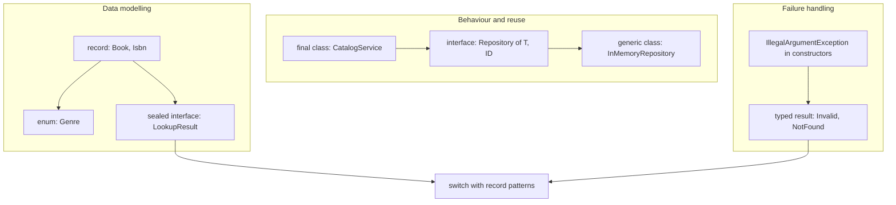

### 3.1 Classes, Objects and Constructors

A class declares state (fields) and behaviour (methods). Each `new` allocates an object on the heap, runs field initialisers and the constructor, and returns a reference.

```java
import java.util.Objects;

public class Account {
    private static int created = 0;            // one per class, shared by all instances

    private final String id;                   // must be assigned exactly once
    private final String owner;
    private long balanceCents;                 // mutable state, private

    public Account(String id, String owner, long openingCents) {
        if (openingCents < 0) {
            throw new IllegalArgumentException("opening balance must be >= 0");
        }
        this.id = Objects.requireNonNull(id, "id");
        this.owner = Objects.requireNonNull(owner, "owner");
        this.balanceCents = openingCents;
        created++;
    }

    public Account(String id, String owner) {
        this(id, owner, 0);                    // delegate to the main constructor
    }

    public void deposit(long cents) {
        if (cents <= 0) throw new IllegalArgumentException("deposit must be positive");
        balanceCents = Math.addExact(balanceCents, cents);
    }

    public long balanceCents() { return balanceCents; }
    public String owner() { return owner; }
    public static int created() { return created; }

    @Override
    public String toString() {
        return "Account[" + id + ", " + owner + ", " + balanceCents + "]";
    }

    public static void main(String[] args) {
        var a = new Account("A-1", "Ada", 500);
        a.deposit(250);
        System.out.println(a + " total accounts: " + Account.created()); // Account[A-1, Ada, 750] total accounts: 1
    }
}
```

Initialisation order for `new Sub()` where `Sub extends Base`:

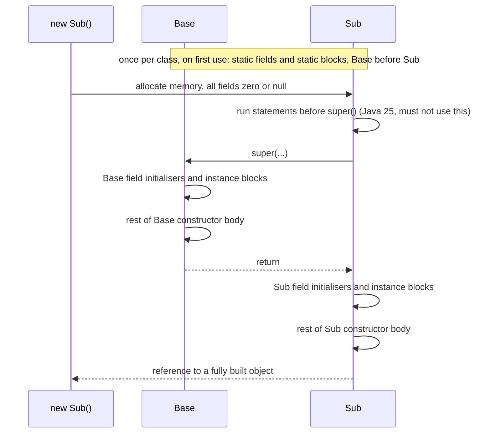

The order explains a classic bug: if `Base`'s constructor calls an overridable method, `Sub`'s override runs before `Sub`'s fields are initialised and sees `null` or `0`. Since Java 25, **flexible constructor bodies** let `Sub` assign its own fields before `super(...)`, which closes that gap:

```java
abstract class Shape {
    Shape() {
        System.out.println("created " + describe());   // calls an overridable method
    }
    abstract String describe();
}

class Label extends Shape {
    private final String text;

    Label(String text) {
        this.text = text.strip();   // Java 25: assigning a field before super() is allowed
        super();                    // Shape() now sees text already set
    }

    @Override
    String describe() {
        return "label '" + text + "'";
    }

    public static void main(String[] args) {
        new Label("  hi ");         // created label 'hi'   (before Java 25 the pattern printed 'null')
    }
}
```

Still, the better rule is to never call overridable methods from a constructor: make the method `private` or `final`, or make the class `final`.

### 3.2 Inheritance, Interfaces and Polymorphism

A class extends one superclass and implements any number of interfaces. Calls to instance methods are dispatched at run time on the object's actual class ("virtual dispatch"); `static`, `private` and `final` methods are not overridable.

```java
import java.util.List;

interface Notifier {
    void send(String to, String message);

    default void sendAll(List<String> recipients, String message) {   // default method
        recipients.forEach(r -> send(r, message));
    }

    static Notifier console() {                                       // static factory
        return (to, msg) -> System.out.println("to " + to + ": " + msg);
    }
}

abstract class RetryingNotifier implements Notifier {
    private final int attempts;

    protected RetryingNotifier(int attempts) { this.attempts = attempts; }

    @Override
    public final void send(String to, String message) {    // template method, not overridable
        for (int i = 1; i <= attempts; i++) {
            if (trySend(to, message)) return;
        }
        throw new IllegalStateException("gave up after " + attempts + " attempts");
    }

    protected abstract boolean trySend(String to, String message);   // the varying step
}

final class FlakySms extends RetryingNotifier {
    private int calls;
    FlakySms() { super(3); }

    @Override
    protected boolean trySend(String to, String message) {
        calls++;
        System.out.println("sms attempt " + calls + " to " + to);
        return calls % 2 == 0;              // fails, then succeeds
    }
}

public class Polymorphism {
    public static void main(String[] args) {
        List<Notifier> notifiers = List.of(Notifier.console(), new FlakySms());
        for (Notifier n : notifiers) {
            n.sendAll(List.of("ada"), "build passed");     // dispatched on the real class
        }
    }
}
```

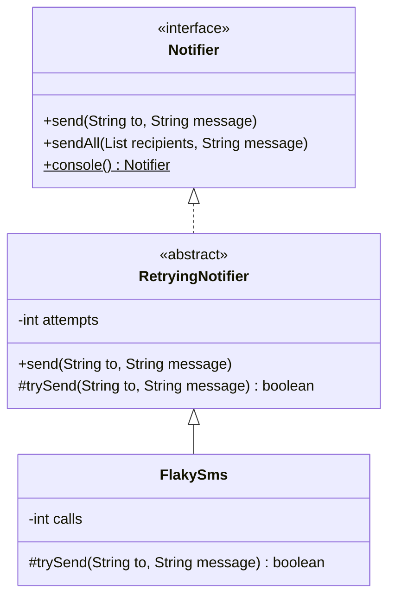

| Tool | Use it for | Limits |
| --- | --- | --- |
| `interface` | A capability or role (`Repository`, `Notifier`), multiple per class | No instance state. Default methods can call other interface methods only. |
| `abstract class` | Shared state plus a skeleton algorithm (template method) | Single inheritance. Couples subclasses to the parent's internals. |
| Composition (a field holding another object) | Reusing behaviour without an "is-a" claim | A few delegating methods to write. |
| `final class` | Classes not designed for extension (most classes) | Cannot be mocked by subclassing; Mockito's inline mock maker still can. |

Prefer composition: `CatalogService` *has a* `Repository`; it does not extend one. Inheritance couples a subclass to every detail of its parent, and a change in the parent ("fragile base class") can break subclasses you have never seen. When you do allow subclassing, document what overriders may rely on, or close the hierarchy with `sealed` (3.5).

Override rules: the overriding method keeps the signature, may return a subtype (covariant return), may not reduce visibility, and may not throw broader checked exceptions. Always add `@Override`; without it a typo such as `equals(Account other)` silently creates an overload instead of an override.

### 3.3 Records: Data Carriers with Validation

A record (Java 16) is a transparent, shallowly immutable carrier for a fixed set of values. From the header the compiler generates private final fields, a canonical constructor, accessors (`isbn()`, not `getIsbn()`), and `equals`, `hashCode` and `toString` based on all components.

The starter's [`Isbn`](src/main/java/com/learninghub/catalog/model/Isbn.java) is a value object that cannot hold an invalid ISBN:

```java
public record Isbn(String value) {

    public Isbn {
        Objects.requireNonNull(value, "value");
        String digits = value.replace("-", "").replace(" ", "");
        if (!digits.matches("\\d{13}")) {
            throw new IllegalArgumentException("ISBN-13 needs exactly 13 digits: '" + value + "'");
        }
        int expected = checkDigit(digits.substring(0, 12));
        int actual = digits.charAt(12) - '0';
        if (expected != actual) {
            throw new IllegalArgumentException(
                    "ISBN-13 checksum failed for '" + value + "': expected check digit " + expected);
        }
        value = digits;
    }

    /** Weights the 12 leading digits 1,3,1,3... and returns the digit that makes the sum a multiple of 10. */
    public static int checkDigit(String first12) {
        if (first12.length() != 12) {
            throw new IllegalArgumentException("need 12 digits, got " + first12.length());
        }
        int sum = 0;
        for (int i = 0; i < 12; i++) {
            int digit = Character.digit(first12.charAt(i), 10);
            if (digit < 0) {
                throw new IllegalArgumentException("not a digit at position " + i);
            }
            sum += (i % 2 == 0) ? digit : digit * 3;
        }
        return (10 - sum % 10) % 10;
    }

    @Override
    public String toString() {
        return value;
    }
}
```

| Line / API | Role | What happens at runtime |
| :--- | :--- | :--- |
| `public record Isbn(String value)` | Record header | Generates `private final String value`, `value()`, `equals`, `hashCode`, `toString`, and the canonical constructor `Isbn(String value)`. |
| `public Isbn { ... }` | Compact canonical constructor | Runs before the generated field assignment. The parameters are in scope by name. |
| `value = digits;` | Reassigning the parameter | Normalises the input; the field receives `"9781000000016"` whatever hyphens were passed. You cannot assign `this.value` in a compact constructor. |
| `digits.matches("\\d{13}")` | Regex shape check | `String.matches` compiles the pattern on each call; fine here, use a `static final Pattern` on hot paths. |
| `throw new IllegalArgumentException(...)` | Reject invalid input | No `Isbn` object exists unless the input is valid. |
| `public static int checkDigit` | Static helper on the record | Records can have static fields and methods, but no extra instance fields. |
| `@Override toString()` | Custom rendering | Generated members can be overridden; here `toString` returns the bare digits. |

[`Book`](src/main/java/com/learninghub/catalog/model/Book.java) adds cross-field validation and a "wither", because records cannot be modified:

```java
public record Book(Isbn isbn, String title, String author, int year, Genre genre, int pages) {

    /** Movable type in Europe dates from the 1450s; nothing in the catalogue is older. */
    public static final int EARLIEST_YEAR = 1450;

    public Book {
        Objects.requireNonNull(isbn, "isbn");
        Objects.requireNonNull(genre, "genre");
        title = requireText(title, "title");
        author = requireText(author, "author");
        int latest = Year.now().getValue() + 1;
        if (year < EARLIEST_YEAR || year > latest) {
            throw new IllegalArgumentException("year must be between " + EARLIEST_YEAR + " and " + latest + ": " + year);
        }
        if (pages <= 0) {
            throw new IllegalArgumentException("pages must be positive: " + pages);
        }
    }

    private static String requireText(String value, String field) {
        if (value == null || value.isBlank()) {
            throw new IllegalArgumentException(field + " must not be blank");
        }
        return value.strip();
    }

    /** A "wither": records are immutable, so a change returns a new instance. */
    public Book withPages(int newPages) {
        return new Book(isbn, title, author, year, genre, newPages);
    }
}
```

| Records can | Records cannot |
| --- | --- |
| Implement interfaces | Extend a class (they extend `java.lang.Record`) |
| Declare static fields, static and instance methods, nested types | Declare instance fields beyond the components |
| Add constructors that delegate to the canonical one | Be subclassed (they are implicitly `final`) |
| Be generic: `record Pair<A, B>(A first, B second)` | Have setters (fields are `final`) |
| Be declared locally inside a method | Hide state: every component is exposed through an accessor |

Records are **shallowly** immutable. A `List` component can still be mutated through the reference unless you copy it in the compact constructor (`items = List.copyOf(items);`). Use records for values, DTOs, map keys, events and results. Use a class when the object has identity and a lifecycle (a connection, an account with a changing balance) or must hide its representation.

### 3.4 Enums: Constants with Behaviour

An enum is a class with a fixed set of instances created when the class initialises. Enums can have fields, constructors, methods and even per-constant method bodies.

```java
import java.util.EnumMap;
import java.util.EnumSet;
import java.util.Map;

public enum Plan {
    FREE(0, 1) {
        @Override boolean canExport() { return false; }
    },
    TEAM(1_500, 10),
    ENTERPRISE(9_900, Integer.MAX_VALUE);

    private final int monthlyCents;
    private final int seats;

    Plan(int monthlyCents, int seats) {          // enum constructors are always private
        this.monthlyCents = monthlyCents;
        this.seats = seats;
    }

    boolean canExport() { return true; }
    int seats() { return seats; }
    int monthlyCents() { return monthlyCents; }

    static Plan cheapestFor(int people) {
        for (Plan p : values()) {                // declaration order
            if (p.seats >= people) return p;
        }
        throw new IllegalArgumentException("no plan fits " + people);
    }

    public static void main(String[] args) {
        System.out.println(cheapestFor(4) + " " + Plan.valueOf("FREE").canExport()); // TEAM false
        EnumSet<Plan> paid = EnumSet.range(TEAM, ENTERPRISE);
        Map<Plan, Integer> users = new EnumMap<>(Plan.class);
        users.put(ENTERPRISE, 2);
        users.put(FREE, 40);
        System.out.println(paid + " " + users);    // [TEAM, ENTERPRISE] {FREE=40, ENTERPRISE=2}
        try {
            Plan.valueOf("free");
        } catch (IllegalArgumentException e) {
            System.out.println(e.getMessage());   // No enum constant Plan.free
        }
    }
}
```

The starter's [`Genre`](src/main/java/com/learninghub/catalog/model/Genre.java) carries a display label, and `CatalogService.countByGenre` collects into an `EnumMap` so the JSON lists genres in declaration order. Persist enums by `name()`, never by `ordinal()`; reordering constants changes ordinals and silently corrupts stored data.

### 3.5 Sealed Types and Pattern Matching

A `sealed` class or interface lists exactly which classes may extend it. Combined with records and pattern matching this gives Java algebraic data types: a closed set of cases that the compiler checks.

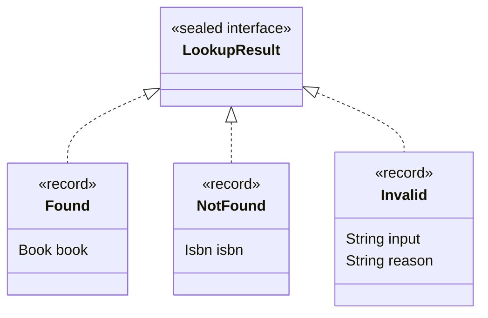

From the starter, [`LookupResult`](src/main/java/com/learninghub/catalog/service/LookupResult.java):

```java
public sealed interface LookupResult {

    record Found(Book book) implements LookupResult {}

    record NotFound(Isbn isbn) implements LookupResult {}

    record Invalid(String input, String reason) implements LookupResult {}
}
```

Because the subtypes are in the same file, `permits` can be omitted. Each permitted subclass must be `final` (records are), `sealed`, or `non-sealed` (which reopens that branch). In a named module the subtypes must be in the same module; on the class path, in the same package.

[`CatalogServer.lookup`](src/main/java/com/learninghub/catalog/http/CatalogServer.java) consumes it with an exhaustive `switch` and record patterns:

```java
private Response lookup(String rawIsbn) {
    return switch (catalog.lookup(rawIsbn)) {
        case LookupResult.Found(Book book) -> Response.ok(book);
        case LookupResult.NotFound(Isbn isbn) -> Response.error(404, "no book with ISBN " + isbn);
        case LookupResult.Invalid(var _, String reason) -> Response.error(400, reason);
    };
}
```

| Line / API | Role | What happens at runtime |
| :--- | :--- | :--- |
| `switch (catalog.lookup(rawIsbn))` | Pattern switch over a sealed type | Tests the cases top to bottom (implemented with an `invokedynamic` type switch). |
| `case LookupResult.Found(Book book)` | Record pattern | Matches the type and binds the component through its accessor. |
| `var _` | Unnamed pattern (Java 22) | Matches anything and binds nothing; documents that `input` is irrelevant here. |
| No `default` | Exhaustiveness | The compiler knows the three cases are all there is. Add a fourth record and this method fails to compile with `the switch expression does not cover all possible input values`. |
| `null` selector | Not handled here | A pattern `switch` without `case null` throws `NullPointerException`, which is correct because `lookup` never returns `null`. |

Patterns also nest and take guards. From [`examples/Shapes.java`](examples/Shapes.java):

```java
sealed interface Shape permits Circle, Rect, Triangle {}

record Circle(double radius) implements Shape { /* validation omitted */ }
record Rect(double width, double height) implements Shape {}
record Triangle(double a, double b, double c) implements Shape { /* triangle inequality check */ }

static double area(Shape shape) {
    return switch (shape) {
        case Circle(double r) -> Math.PI * r * r;
        case Rect(double w, double h) when w == h -> w * w;   // guard: a square
        case Rect(double w, double h) -> w * h;
        case Triangle(double a, double b, double c) -> {
            double s = (a + b + c) / 2;                          // Heron's formula
            yield Math.sqrt(s * (s - a) * (s - b) * (s - c));
        }
    };
}
```

```bash
java examples/Shapes.java
# Circle[radius=1.0]                       area=3.14
# Rect[width=2.0, height=2.0]              area=4.00
# Rect[width=2.0, height=5.0]              area=10.00
# Triangle[a=3.0, b=4.0, c=5.0]            area=6.00
# largest: Rect[width=2.0, height=5.0]
# error: unknown shape 'hexagon'
# error: cannot parse 'rect two 3': For input string: "two"
# error: cannot parse 'triangle 1 1 9': not a triangle: 1.0, 1.0, 9.0
```

| Approach | Adding a new case | Adding a new operation | Compiler help |
| --- | --- | --- | --- |
| Sealed interface + pattern `switch` | Edit every switch (the compiler lists them) | Write one new method | Exhaustiveness errors |
| Abstract method on a class hierarchy (classic OOP) | Add one class | Edit every class | Missing-override errors |
| Visitor pattern | Edit the visitor interface and every visitor | Write one visitor | Yes, but verbose |
| Enum + `switch` | Add a constant | One switch | Exhaustiveness errors; cases cannot carry different data |

Use sealed types when the set of cases is part of your domain and changes rarely (results, commands, events, AST nodes). Use an open interface with polymorphic methods when third parties must add implementations.

`instanceof` patterns (Java 16) cover the one-case version: `if (obj instanceof String s && !s.isBlank()) { ... }`. Since Java 21 they accept record patterns too: `if (largest instanceof Rect(double w, double h) && w * h == 10.0)`.

### 3.6 Generics: Type Parameters, Wildcards and PECS

Generics let one class or method work with many types while the compiler checks them. The starter's [`InMemoryRepository`](src/main/java/com/learninghub/catalog/store/InMemoryRepository.java):

```java
public final class InMemoryRepository<T, ID> implements Repository<T, ID> {

    private final Map<ID, T> items = new ConcurrentHashMap<>();
    private final Function<? super T, ? extends ID> idOf;
    private final Comparator<? super T> order;

    public InMemoryRepository(Function<? super T, ? extends ID> idOf, Comparator<? super T> order) {
        this.idOf = Objects.requireNonNull(idOf, "idOf");
        this.order = Objects.requireNonNull(order, "order");
    }

    @Override
    public Optional<T> findById(ID id) {
        return Optional.ofNullable(items.get(id));
    }

    @Override
    public List<T> findAll() {
        List<T> copy = new ArrayList<>(items.values());
        copy.sort(order);
        return List.copyOf(copy);
    }

    @Override
    public T save(T entity) {
        Objects.requireNonNull(entity, "entity");
        items.put(idOf.apply(entity), entity);
        return entity;
    }

    @Override
    public boolean deleteById(ID id) {
        return items.remove(id) != null;
    }

    @Override
    public int count() {
        return items.size();
    }
}
```

| Line / API | Role | What happens at runtime |
| :--- | :--- | :--- |
| `class InMemoryRepository<T, ID>` | Type parameters | Erased to `Object` in bytecode; the compiler inserts casts where values come out. |
| `Function<? super T, ? extends ID> idOf` | Wildcards (PECS) | Accepts a function written for a supertype of `T` (it *consumes* `T`) that returns a subtype of `ID` (it *produces* `ID`). |
| `Comparator<? super T> order` | Consumer wildcard | A `Comparator<Object>` or `Comparator<Book>` both work for `T = Book`. |
| `ConcurrentHashMap<ID, T>` | Thread-safe map | The HTTP server calls the repository from many virtual threads at once. It rejects `null` keys and values. |
| `List.copyOf(copy)` | Immutable snapshot | Callers cannot mutate the repository through the returned list. |

**PECS: Producer Extends, Consumer Super.** If a parameter gives you `T`s, declare it `? extends T`. If it accepts `T`s, declare it `? super T`. The JDK's own signatures follow this rule:

```java
import java.util.ArrayList;
import java.util.Collection;
import java.util.List;

public class Pecs {
    // src produces Ts, dst consumes Ts
    static <T> void copy(List<? extends T> src, Collection<? super T> dst) {
        for (T item : src) {
            dst.add(item);
        }
    }

    // A bounded type parameter: T must be comparable to itself (or a supertype)
    static <T extends Comparable<? super T>> T max(List<? extends T> xs) {
        T best = xs.getFirst();
        for (T x : xs) {
            if (x.compareTo(best) > 0) best = x;
        }
        return best;
    }

    public static void main(String[] args) {
        List<Integer> ints = List.of(3, 1, 4);
        List<Number> numbers = new ArrayList<>();
        copy(ints, numbers);                          // Integer extends Number: allowed
        System.out.println(numbers + " max=" + max(ints)); // [3, 1, 4] max=4

        List<? extends Number> readOnly = ints;
        Number first = readOnly.getFirst();           // reading is fine
        // readOnly.add(5);                           // compile error: capture of ? extends Number
        System.out.println(first);
    }
}
```

| Declaration | You can read as | You can add | Example |
| --- | --- | --- | --- |
| `List<Number>` | `Number` | `Number` and subtypes | General-purpose list |
| `List<? extends Number>` | `Number` | nothing except `null` | Method that sums any numeric list |
| `List<? super Integer>` | `Object` | `Integer` | Method that fills a list with integers |
| `List<?>` | `Object` | nothing except `null` | Method that only needs `size()` or `clear()` |

Generics are **invariant**: a `List<Integer>` is not a `List<Number>`, even though `Integer` is a `Number`. Arrays are covariant, which is why `Object[] o = new String[1]; o[0] = 1;` compiles and fails at run time with `ArrayStoreException` (2.2), while the generic equivalent fails at compile time.

### 3.7 Type Erasure and Its Consequences

Generic type arguments exist only at compile time. The compiler checks them, then erases them: `List<String>` and `List<Integer>` are the same class, `java.util.ArrayList`, at run time. That design kept old non-generic code working in Java 5, and it explains several rules:

```java
import java.util.ArrayList;
import java.util.List;

public class Erasure {
    static <T> T[] badArray(int n) {
        // return new T[n];                 // error: generic array creation
        @SuppressWarnings("unchecked")
        T[] result = (T[]) new Object[n];   // compiles, but the real type is Object[]
        return result;
    }

    @SuppressWarnings({"unchecked", "rawtypes"})
    public static void main(String[] args) {
        List<String> strings = new ArrayList<>();
        List<Integer> ints = new ArrayList<>();
        System.out.println(strings.getClass() == ints.getClass());   // true

        // if (strings instanceof List<String>) {}  // allowed since 16 only because it is statically known
        Object o = strings;
        System.out.println(o instanceof List<?>);                    // true: wildcard is reifiable

        List raw = strings;                 // raw type: generics switched off
        raw.add(42);                        // heap pollution, only a warning
        try {
            String s = strings.get(0);      // ClassCastException here, far from the cause
            System.out.println(s);
        } catch (ClassCastException e) {
            System.out.println("CCE: " + e.getMessage());
        }

        try {
            String[] arr = Erasure.<String>badArray(1);   // ClassCastException: Object[] is not String[]
            System.out.println(arr.length);
        } catch (ClassCastException e) {
            System.out.println("CCE from generic array");
        }
    }
}
```

| You cannot | Because | Do instead |
| --- | --- | --- |
| `new T()` or `new T[n]` | `T` is unknown at run time | Pass a `Supplier<T>` or `IntFunction<T[]>` (`String[]::new`), or a `Class<T>` |
| Overload `f(List<String>)` and `f(List<Integer>)` | Both erase to `f(List)` | Use different method names |
| `catch (MyException<T> e)` | Generic classes cannot extend `Throwable` | Put the type information in a field |
| `instanceof List<String>` on an `Object` | No type argument at run time | `instanceof List<?>`, then check elements |
| Use primitives as type arguments (`List<int>`) | Type arguments must be reference types | `List<Integer>`, or `IntStream`/`int[]` for performance (value classes from Project Valhalla aim to change this) |

`javac -Xlint:unchecked` warns at every place where erasure can let the wrong type in. The starter compiles with `-Xlint:all -Werror`, so a raw type or unchecked cast fails the build unless it is deliberately suppressed on the smallest possible scope, as `badArray` shows.

### 3.8 Exceptions: Checked, Unchecked and `try`-with-resources

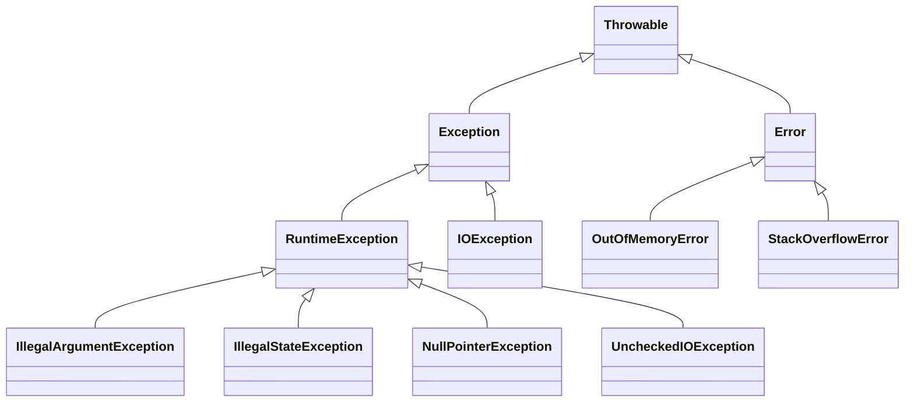

| Kind | Examples | Compiler forces you to handle it? | Use for |
| --- | --- | --- | --- |
| Checked (`Exception`, not `RuntimeException`) | `IOException`, `SQLException`, `InterruptedException` | Yes: catch or declare `throws` | Expected, recoverable failures of the environment |
| Unchecked (`RuntimeException`) | `IllegalArgumentException`, `IllegalStateException`, `NullPointerException` | No | Programming errors and broken preconditions |
| `Error` | `OutOfMemoryError`, `StackOverflowError` | No | JVM-level problems; do not catch them in normal code |

`try`-with-resources closes every resource declared in its header, in reverse order, even when the body throws. If `close()` also throws, that exception is attached to the primary one as **suppressed** instead of replacing it:

```java
public class Resources {
    record Res(String name, boolean failOnClose) implements AutoCloseable {
        Res {
            System.out.println("open " + name);
        }
        @Override
        public void close() {
            System.out.println("close " + name);
            if (failOnClose) throw new IllegalStateException("close failed: " + name);
        }
    }

    public static void main(String[] args) {
        try (var a = new Res("a", false); var b = new Res("b", true)) {
            System.out.println("using " + a.name() + " and " + b.name());
            throw new RuntimeException("body failed");
        } catch (RuntimeException e) {
            System.out.println("caught: " + e.getMessage());
            for (Throwable s : e.getSuppressed()) {
                System.out.println("  suppressed: " + s.getMessage());
            }
        } finally {
            System.out.println("finally runs last");
        }
    }
}
// open a / open b / using a and b / close b / close a
// caught: body failed /   suppressed: close failed: b / finally runs last
```

The starter's exception strategy, end to end:

| Layer | Code | What it does with failure |
| --- | --- | --- |
| Model | `new Isbn("123")` | Throws `IllegalArgumentException`: an invalid ISBN cannot exist. |
| Service | `CatalogService.lookup` | Catches that exception and returns `LookupResult.Invalid`, a value the caller must handle. |
| HTTP | `CatalogServer.lookup` | Maps `Invalid` to 400 and `NotFound` to 404 with an exhaustive switch. |
| HTTP | `CatalogServer.handle` | Catches any other `RuntimeException`, logs it with `System.Logger`, returns 500, and always closes the exchange in `finally`. |
| Entry | `App.parsePort` | Wraps `NumberFormatException` with context and keeps it as the cause. |

Rules worth following:

- **Throw early, catch late.** Validate at the boundary (constructors, request parsing) and handle at the layer that can do something useful (the HTTP layer turns failures into status codes).
- **Keep the cause.** `throw new IllegalArgumentException("PORT is not a number: " + raw, e)`; dropping `e` loses the stack trace that shows where things went wrong.
- **Never swallow.** An empty `catch` block hides bugs. If ignoring is right, name the variable `_` (Java 22) or `ignored` and say why.
- **Restore the interrupt flag.** When you catch `InterruptedException` and cannot rethrow it, call `Thread.currentThread().interrupt()` so callers can still see the cancellation. Do this only for `InterruptedException`, not for every exception in the same `catch`.
- **Do not use exceptions for normal control flow.** Building a stack trace costs microseconds; for expected outcomes such as "not found" return `Optional` or a sealed result.
- **Do not `return` from `finally`.** It discards any exception thrown in the `try` block.

### 3.9 Immutability and Defensive Design

An immutable object cannot change after construction. It is automatically thread-safe, can be shared and cached freely, and is a safe map key. The recipe:

1. Make the class `final` (or use a record).
2. Make every field `private final`.
3. Validate in the constructor, so every instance is valid.
4. Copy mutable inputs on the way in (`List.copyOf`) and never hand out internal mutable objects.
5. Offer "withers" that return new instances instead of setters.

```java
import java.time.LocalDate;
import java.util.Date;
import java.util.List;

public class Immutability {
    // Shallow trap: the record is "immutable", but the list and Date inside are not.
    record LeakyOrder(List<String> items, Date placed) {}

    // Deep: copy collections, use immutable java.time types.
    record Order(List<String> items, LocalDate placed) {
        Order {
            items = List.copyOf(items);         // also rejects null elements
        }
        Order withItem(String item) {
            var next = new java.util.ArrayList<>(items);
            next.add(item);
            return new Order(next, placed);
        }
    }

    public static void main(String[] args) {
        var source = new java.util.ArrayList<>(List.of("pen"));
        var leaky = new LeakyOrder(source, new Date());
        source.add("ink");
        leaky.placed().setTime(0);
        System.out.println(leaky.items() + " " + leaky.placed().getTime());   // [pen, ink] 0

        var order = new Order(source, LocalDate.of(2026, 1, 15));
        source.add("paper");
        System.out.println(order.items() + " -> " + order.withItem("stamp").items());
        // [pen, ink] -> [pen, ink, stamp]
    }
}
```

| Mutable legacy type | Immutable replacement |
| --- | --- |
| `java.util.Date`, `Calendar` | `Instant`, `LocalDate`, `ZonedDateTime` (`java.time`, Java 8) |
| `SimpleDateFormat` (also not thread-safe) | `DateTimeFormatter` |
| `StringBuffer`/`StringBuilder` as a field | `String` |
| Arrays as fields | `List.copyOf`, or clone on the way in and out |
| JavaBeans with setters | Records with withers, or builders |

### 3.10 Objects in Memory: Stack, Heap, References and `null`

Each thread has a **stack** of frames; each frame holds the method's local variables and operand stack. Primitives in locals live in the frame. Objects always live on the **heap**, and variables hold references (pointers) to them. The garbage collector reclaims objects that no live reference can reach.

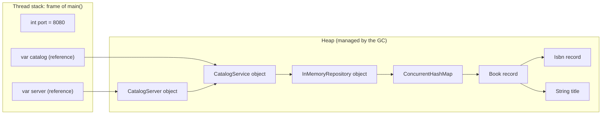

What an object costs on 64-bit HotSpot with default settings:

| Part | Size |
| --- | --- |
| Header (mark word + compressed class pointer) | 12 bytes (8 with `-XX:+UseCompactObjectHeaders`, Java 25) |
| `int`, `float` field | 4 bytes |
| `long`, `double` field | 8 bytes |
| Reference field | 4 bytes with compressed oops (heaps under about 32 GB), otherwise 8 |
| Alignment | Objects are padded to a multiple of 8 bytes |
| Example: `Integer` | 12 header + 4 value = 16 bytes, versus 4 bytes for an `int` in an array |

That is why `List<Integer>` with a million elements uses several times the memory of an `int[]` of the same length, and why Stage 6 cares about allocation rates.

`null` is the absence of a reference. Dereferencing it throws `NullPointerException`. Since Java 14 the message names the exact expression (`Cannot invoke "String.length()" because "<local1>" is null`; compile with `-g` to see variable names). Defend against `null` at boundaries with `Objects.requireNonNull(x, "x")`, as every constructor in the starter does, and avoid returning `null` from your own methods: return `Optional`, an empty collection, or a sealed "not found" case.

### 3.11 Walkthrough: the JSON Writer and Pattern-Matching `switch`

The starter writes JSON without a library, which makes a good tour of pattern matching over arbitrary types. From [`Json.java`](src/main/java/com/learninghub/catalog/http/Json.java):

```java
private static void append(StringBuilder out, Object value) {
    switch (value) {
        case null -> out.append("null");
        case String s -> quote(out, s);
        case Boolean b -> out.append(b.booleanValue());
        case Double d when d.isNaN() || d.isInfinite() ->
                throw new IllegalArgumentException("JSON cannot represent " + d);
        case Number n -> out.append(n);
        case Enum<?> e -> quote(out, e.name());
        // Isbn is a record, so this case must come before "case Record":
        // the compiler rejects a case that an earlier case dominates.
        case Isbn isbn -> quote(out, isbn.value());
        case Map<?, ?> map -> appendMap(out, map);
        case Collection<?> items -> appendCollection(out, items);
        case Record record -> appendRecord(out, record);
        default -> throw new IllegalArgumentException(
                "unsupported type for JSON: " + value.getClass().getName());
    }
}

private static void appendRecord(StringBuilder out, Record record) {
    out.append('{');
    RecordComponent[] components = record.getClass().getRecordComponents();
    for (int i = 0; i < components.length; i++) {
        if (i > 0) {
            out.append(',');
        }
        quote(out, components[i].getName());
        out.append(':');
        try {
            append(out, components[i].getAccessor().invoke(record));
        } catch (IllegalAccessException | InvocationTargetException e) {
            throw new IllegalStateException("cannot read " + components[i].getName(), e);
        }
    }
    out.append('}');
}
```

| Line / API | Role | What happens at runtime |
| :--- | :--- | :--- |
| `case null` | Explicit null case | Without it, a pattern `switch` throws `NullPointerException` for a `null` selector. |
| `case Double d when ...` | Guarded pattern | Matches only NaN and infinity; other doubles fall through to `case Number n`. |
| Case order | Dominance | A case that an earlier case already covers is a compile error (`this case label is dominated by a preceding case label`). Moving `case Record` above `case Isbn` would trigger it. |
| `case Map<?, ?> map` | Wildcard type pattern | Erasure means only `Map<?, ?>` can be tested, not `Map<String, Object>`. |
| `getRecordComponents()` / `getAccessor().invoke` | Record reflection | Reads components in declaration order, so JSON field order matches the record header. |
| `IllegalAccessException` | Reflection access check | Thrown for records that are not public; the writer documents that it serialises public records only. |
| `default -> throw` | Fail loudly | Unknown types are a programming error, not something to guess at. |

A switch over `Object` cannot be exhaustive, so it needs `default`. A switch over the sealed `LookupResult` does not. That difference is the practical payoff of sealing a hierarchy.

### 3.12 Pitfalls

| Pitfall | Symptom | Fix |
| --- | --- | --- |
| Overridable method called from a constructor | Subclass override sees `null` fields | Make the method `private`/`final`, or the class `final`; in Java 25 assign fields before `super()`. |
| `equals(Account other)` instead of `equals(Object o)` | `HashSet.contains` ignores your method; no error | Always use `@Override`; the compiler then reports `method does not override or implement a method from a supertype`. |
| Record with a mutable component | "Immutable" record changes after construction | Copy in the compact constructor: `items = List.copyOf(items)`. |
| Assigning `this.x` in a compact constructor | `error: cannot assign a value to final variable x` | Reassign the parameter (`x = normalise(x);`); the field is assigned after the body. |
| Adding a case to a sealed interface | `error: the switch expression does not cover all possible input values` in every switch | That is the feature: handle the new case in each listed switch. |
| Case order in a pattern switch | `error: this case label is dominated by a preceding case label` | Put specific types and guarded cases before general ones. |
| Pattern `switch` on a possibly-null value | `NullPointerException` from the switch | Add `case null ->` or guarantee non-null. |
| Storing `ordinal()` | Data corrupts when constants are reordered | Store `name()` or an explicit code field. |
| Expecting `List<Integer>` to be a `List<Number>` | `incompatible types: List<Integer> cannot be converted to List<Number>` | Declare the parameter `List<? extends Number>`. |
| Raw types | `warning: [unchecked] unchecked call to add(E) as a member of the raw type List`, then `ClassCastException` later | Always supply type arguments; treat unchecked warnings as errors. |
| `catch (Exception e) {}` | Failures vanish; bug reports with no trace | Catch the specific type, log or rethrow with the cause. |
| Catching `InterruptedException` together with others and calling `interrupt()` for all | Thread flagged as interrupted after an unrelated error | Handle `InterruptedException` in its own `catch`. |
| `return` inside `finally` | Exception from `try` disappears | Never return or throw from `finally`. |
| Related types in a multi-catch | `error: Alternatives in a multi-catch statement cannot be related by subclassing` | Catch only the superclass. |

### 3.13 Best Practices

- **Make classes `final` unless designed for extension**: it keeps invariants local and lets you change internals safely.
- **Validate in constructors**: an object that exists is valid, so methods need no defensive checks.
- **Use records for values and results**: generated `equals`/`hashCode` are always consistent.
- **Model closed sets of outcomes as sealed types**: exhaustive switches turn new cases into compile errors, not production bugs.
- **Prefer composition to inheritance**: hold a collaborator in a field and delegate.
- **Apply PECS to public generic APIs**: `? extends` for inputs you read, `? super` for inputs you write to.
- **Treat unchecked warnings as errors**: they mark exactly where erasure can break type safety.
- **Use unchecked exceptions for broken preconditions and checked ones only where callers can recover**: it keeps signatures honest without `throws Exception` everywhere.
- **Always keep the cause when wrapping exceptions**: the original stack trace is the most useful debugging data you have.
- **Prefer `java.time` and immutable collections**: they remove whole classes of aliasing and threading bugs.

### 3.14 Hands-on Exercise

Add a fourth lookup outcome to the starter and let the compiler guide you.

1. In [`LookupResult`](src/main/java/com/learninghub/catalog/service/LookupResult.java) add `record Withdrawn(Book book, String reason) implements LookupResult {}`.
2. Run `./gradlew build`. The build fails in `CatalogServer.lookup` and in `CatalogServiceTest.exhaustiveSwitchNeedsNoDefault` with `the switch expression does not cover all possible input values`. Those are the only places that need changes.
3. In `CatalogService`, keep a `Set<Isbn>` of withdrawn ISBNs (constructor parameter, defensively copied with `Set.copyOf`) and return `Withdrawn` for them.
4. In `CatalogServer.lookup`, map `Withdrawn` to HTTP `410 Gone` with the reason in the error body.
5. Add tests for both layers.

Expected output after wiring `978-1-00-000002-3` as withdrawn:

```bash
curl -s -w '\n%{http_code}\n' localhost:8080/books/978-1-00-000002-3
# {"error":"withdrawn: superseded by a second edition"}
# 410
```

Stretch: add a generic `record Page<T>(List<T> items, int page, int size, long total)` with a compact constructor that rejects `page < 0` and `size <= 0` and copies `items`, and return it from `GET /books?page=0&size=2`. Confirm that `Json` serialises it without changes, because it is a public record.

[Back to top ⤴️](#-table-of-contents)

---

## 4. Stage 4: Concurrency, Virtual Threads & the Java Memory Model

Java's concurrency model from platform threads to virtual threads, and the memory model rules that decide what one thread can see of another's writes. Prerequisite: Stage 3. Afterwards you can explain why the starter runs every request on its own virtual thread and when that stops being safe.

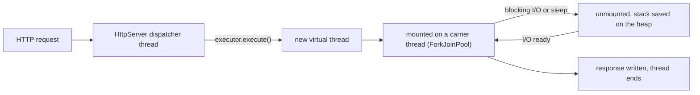

Planned sections: platform threads and the `Thread` API; executors and thread pools; virtual threads and carrier threads; `CompletableFuture`; locks, atomics and concurrent collections; the Java Memory Model, happens-before and `volatile`; structured concurrency and scoped values; pitfalls, best practices and an exercise that load-tests the starter.

[Back to top ⤴️](#-table-of-contents)

---

## 5. Stage 5: I/O, Networking, Persistence & Testing

Files, HTTP clients and servers, databases and the test pyramid. Prerequisite: Stage 4. Afterwards you can replace the starter's in-memory repository with a JDBC one and test it against a real database.

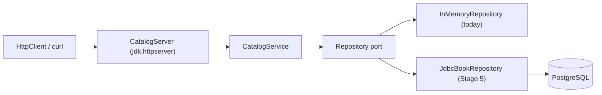

Planned sections: `java.nio.file` and streams of lines; `HttpClient` (HTTP/2, plus HTTP/3 from Java 26, JEP 517); the JDK `HttpServer` in depth; JSON libraries compared with the starter's writer; JDBC, `PreparedStatement`, transactions and connection pools; JUnit Jupiter features; Mockito; Testcontainers; pitfalls, best practices and an exercise.

[Back to top ⤴️](#-table-of-contents)

---

## 6. Stage 6: Performance, Profiling, Security & Deployment

How a JVM service behaves under load and in a container, and how to ship it safely. Prerequisite: Stage 5. Afterwards you can size a heap for a container, read a JFR recording, benchmark with JMH and build a small non-root image.

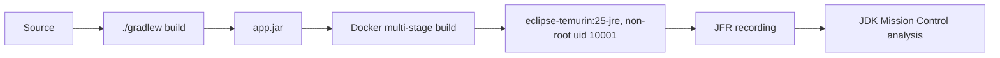

Planned sections: G1, ZGC, Shenandoah and Parallel GC compared; heap sizing with `MaxRAMPercentage` and container limits; JFR and JDK Mission Control; JMH benchmarks; `jlink` custom runtimes and the AOT cache; secure coding, deserialisation and dependency scanning; the starter's Dockerfile line by line; pitfalls, best practices and an exercise.

[Back to top ⤴️](#-table-of-contents)

---

## M1. Masterclass: Virtual Threads and Structured Concurrency Internals

Continuations, carrier-thread scheduling, why pinning in `synchronized` went away in Java 24, the remaining pinning cases (native frames), `StructuredTaskScope` in its current preview form, and `ScopedValue` inheritance. Worked example: fan-out lookups with deadlines.

[Back to top ⤴️](#-table-of-contents)

---

## M2. Masterclass: Garbage Collection and Memory Tuning

Generational hypothesis, G1 regions and mixed collections, ZGC coloured pointers and load barriers, generational Shenandoah, compact object headers, and a method for tuning from GC logs rather than folklore.

[Back to top ⤴️](#-table-of-contents)

---

## M3. Masterclass: Startup, AOT Cache and Native Images

Class data sharing, the Java 24-25 AOT cache, CRaC-style checkpointing, and GraalVM Native Image compared on startup, peak throughput, memory and build cost.

[Back to top ⤴️](#-table-of-contents)

---

## M4. Masterclass: Project Panama, Foreign Memory and the Vector API

`Linker`, `SymbolLookup`, `Arena` and `MemorySegment` replacing JNI and `Unsafe`, `jextract`, and the incubating Vector API for SIMD.

[Back to top ⤴️](#-table-of-contents)

---

## M5. Masterclass: Flagship Blueprint, a Production Catalogue Service

The starter grown into a production service: JDBC persistence, structured concurrency, JFR events, health and readiness, graceful shutdown, a `jlink` image with an AOT cache, and CI that proves all of it.

[Back to top ⤴️](#-table-of-contents)

---

## 7. Stage 7: Staff Java Engineer Interview Handbook & Cheatsheet

### 7.1 Core Concepts (Q1-Q2)

#### Q1. What are the fundamental architectural trade-offs of choosing Java for a backend system?

Java trades startup time and memory footprint for peak throughput, tooling and operational maturity. A HotSpot JVM starts in the interpreter and reaches full speed only after the JIT has profiled and compiled hot code, so the first seconds of a new instance are slower and a minimal service uses tens of megabytes of heap plus metaspace, code cache and thread stacks. In return, long-running services get profile-guided optimisation that static compilers cannot do, a choice of garbage collectors tuned for throughput or latency, and production diagnostics (JFR, `jcmd`, heap dumps, thread dumps) that are built into every JDK.

The second trade-off is ecosystem breadth against complexity. Maven Central, mature drivers, and frameworks such as Spring Boot, Quarkus, Micronaut and Helidon mean most integration problems are already solved, but dependency trees get deep, and reflection-heavy frameworks add startup cost and upgrade friction. The language itself is conservative: features arrive through previews and stay backward compatible, which makes 15-year-old code bases upgradable but means Java gains features later than Kotlin or C#.

| Concern | Java's position | Mitigation when it matters |
| --- | --- | --- |
| Startup and warm-up | Slower than native binaries | AOT cache (Java 24+), CDS, GraalVM Native Image, CRaC |
| Memory per instance | Higher baseline | Right-size the heap, compact object headers, `jlink` runtimes |
| Peak throughput | Excellent after JIT warm-up | Keep instances long-lived, avoid needless redeploys |
| Concurrency | Virtual threads give cheap blocking concurrency | Avoid native pinning, bound downstream resources |
| Hiring and longevity | Very large talent pool, strong compatibility | Stay on LTS releases, upgrade every LTS |

#### Q2. How do you design a Java service for zero-downtime deployment and failover?

Start with the process. The service must start, report readiness only when it can serve, and stop gracefully: on SIGTERM it stops accepting new connections, finishes in-flight requests within a deadline, closes pools and exits. The starter shows the minimum, a shutdown hook that calls `server.stop(0)` and closes the executor; a production version passes a drain delay to `stop`, separates liveness (`/health`, "the process is alive") from readiness ("dependencies are reachable, warm-up done"), and keeps the orchestrator's termination grace period longer than the drain time.

Then the fleet. Run at least two instances behind a load balancer, roll out one instance at a time (or blue-green), and make every write idempotent so a client or proxy can retry safely after a failover: an idempotency key stored with the result, or upserts keyed by a natural ID. Keep instances stateless (sessions in a shared store or tokens), make schema changes backward compatible across two releases (expand, migrate, contract), and put timeouts, bounded retries with jitter and circuit breakers around every remote call so one slow dependency cannot exhaust the request threads. Finally, warm up: JIT warm-up means a fresh instance is slower, so ramp traffic gradually, or use an AOT cache to shorten the cold phase.

```mermaid
sequenceDiagram
    participant O as Orchestrator
    participant LB as Load balancer
    participant N as New instance
    participant OLD as Old instance
    O->>N: start
    N-->>O: readiness probe OK after warm-up
    O->>LB: add N
    O->>OLD: SIGTERM
    OLD->>LB: readiness fails, removed from rotation
    OLD->>OLD: drain in-flight requests, close pools
    OLD-->>O: exit 0 before the grace period ends
```

### 7.5 Staff Cheatsheet

| Need | Java answer | Gotcha |
| --- | --- | --- |
| Configuration at startup | Read and validate env vars in `main`, fail fast (`App.parsePort`) | A typo in a variable name silently falls back to the default; log the effective configuration. |
| Value types | `record` with a compact constructor | Shallow immutability: copy mutable components. |
| Closed set of outcomes | `sealed interface` + records + exhaustive `switch` | Pattern `switch` throws NPE on `null` unless you add `case null`. |
| Errors | Unchecked for bugs, checked or typed results for expected failures | Never swallow; keep the cause; restore the interrupt flag. |
| Blocking concurrency | `Executors.newVirtualThreadPerTaskExecutor()` | Virtual threads do not limit load; bound connection pools and use semaphores. |
| Resource cleanup | `try`-with-resources and shutdown hooks | Shutdown hooks do not run on `kill -9` or a container OOM kill. |
| Collections | `List.of`, `List.copyOf`, `stream().toList()` | Immutable factories reject `null`; `Set.of`/`Map.of` order is randomised. |

[Back to top ⤴️](#-table-of-contents)

---

## 🧪 Example Projects

| Project | Builds on | What you practise | Stretch goal |
| --- | --- | --- | --- |
| [Starter catalogue service](./src/main/java/com/learninghub/catalog) (in this repo) | [Stage 1](#1-stage-1-toolchain-jvm-model--language-basics), [Stage 2](#2-stage-2-methods-collections-streams--packages), [Stage 3](#3-stage-3-oop-records-sealed-types-generics--exceptions) | Records, sealed results, generics, streams, JDK `HttpServer`, JUnit | Do the exercises in 1.14, 2.13 and 3.14. |
| Log analyser CLI | [2.7 Streams](#27-streams-pipelines-collectors-and-gatherers), [1.7 Strings](#17-strings-text-blocks-and-formatting) | `Files.lines`, `groupingBy`, gatherers for sliding windows | Report the p50/p95/p99 latency per endpoint from an access log. |
| Expression evaluator | [3.5 Sealed types](#35-sealed-types-and-pattern-matching), [3.8 Exceptions](#38-exceptions-checked-unchecked-and-try-with-resources) | Sealed AST, recursive pattern `switch`, a hand-written parser | Add variables and a simplifier that folds constants. |
| Generic LRU cache | [3.6 Generics](#36-generics-type-parameters-wildcards-and-pecs), [2.3 Collections](#23-the-collections-framework-list-set-map-and-sequenced-collections) | `LinkedHashMap` access order, `SequencedMap`, bounded type parameters | Make it thread-safe and measure contention (Stage 4). |
| Concurrent link checker | [Stage 4](#4-stage-4-concurrency-virtual-threads--the-java-memory-model) | Virtual threads, `HttpClient`, timeouts, semaphores | Use structured concurrency so one failure cancels the rest. |
| URL shortener with PostgreSQL | [Stage 5](#5-stage-5-io-networking-persistence--testing) | JDBC, transactions, connection pools, Testcontainers | Add idempotent creation with an idempotency key. |
| Rate-limiter library | [Stage 6](#6-stage-6-performance-profiling-security--deployment) | Token bucket, `AtomicLong`, JMH benchmarks | Compare lock-free and `ReentrantLock` versions under contention. |
| Event-sourced ledger | [M5](#m5-masterclass-flagship-blueprint-a-production-catalogue-service) | Records as events, sealed commands, snapshots, JFR events | Rebuild projections from the event log at startup with an AOT cache. |

## 📝 Cheat Sheets

### CLI / Commands

```bash
# JDK tools
java -version                              # runtime version (prints to stderr)
java Hello.java                            # run a source file without compiling first
javac -d out --release 25 $(find src -name '*.java')
java -cp out com.example.Main              # run a class from a directory
jar --create --file app.jar --main-class com.example.Main -C out .
java -jar app.jar
jshell                                     # REPL: /vars /methods /imports /exit
javap -c -p -cp out com.example.Main       # disassemble bytecode
jdeps --jdk-internals app.jar              # find uses of JDK internals
jcmd                                       # list running JVMs
jcmd <pid> Thread.print                    # thread dump
jcmd <pid> GC.heap_info                    # heap summary
jcmd <pid> JFR.start duration=60s filename=rec.jfr
jfr print --events jdk.GarbageCollection rec.jfr
java -XX:+PrintFlagsFinal -version | grep -i maxheap

# Gradle wrapper (this repo)
./gradlew build                            # compile (-Xlint:all -Werror), test, jar
./gradlew test --tests '*CatalogServerTest' # one test class
./gradlew run                              # start the starter on PORT or 8080
./gradlew dependencies --configuration runtimeClasspath
./gradlew wrapper --gradle-version 9.8.2   # upgrade the wrapper

# Maven equivalents
./mvnw verify
./mvnw -Dtest=CatalogServerTest test
./mvnw dependency:tree

# Docker (this repo)
docker build -t learn-java .
docker run --rm -p 8080:8080 learn-java
curl -s localhost:8080/health
```

### Syntax Quick Reference

| Task | Code |
| --- | --- |
| Compact program (Java 25) | `void main() { IO.println("hi"); }` |
| Local type inference | `var names = new ArrayList<String>();` |
| Text block | Open with `"""` and a line break, close with `"""`; indentation is stripped (see 1.7) |
| Switch expression | `int n = switch (day) { case SAT, SUN -> 0; default -> 1; };` |
| Record | `record Point(int x, int y) {}` |
| Compact constructor | `record Range(int lo, int hi) { Range { if (lo > hi) throw new IllegalArgumentException(); } }` |
| Sealed hierarchy | `sealed interface Shape permits Circle, Square {}` |
| Record pattern | `if (o instanceof Point(int x, int y)) { ... }` |
| Guarded case | `case Rect(double w, double h) when w == h -> ...` |
| Unnamed variable | `catch (NumberFormatException _) { ... }` |
| Immutable collections | `List.of(1, 2)`, `Map.of("k", 1)`, `List.copyOf(xs)` |
| Sequenced access | `list.getFirst()`, `list.getLast()`, `list.reversed()` |
| Group and count | `xs.stream().collect(groupingBy(f, counting()))` |
| Merge into a map | `counts.merge(word, 1L, Long::sum)` |
| Optional chain | `find(id).map(Book::title).orElse("?")` |
| Generic method | `static <T extends Comparable<? super T>> T max(List<? extends T> xs)` |
| Try-with-resources | `try (var in = Files.newBufferedReader(p)) { ... }` |
| Virtual-thread executor | `try (var ex = Executors.newVirtualThreadPerTaskExecutor()) { ex.submit(task); }` |
| Module import (Java 25) | `import module java.base;` |

## 📚 Resources

- [Java SE 25 documentation and API](https://docs.oracle.com/en/java/javase/25/)
- [JDK 25 project page and JEP list](https://openjdk.org/projects/jdk/25/)
- [Java Language and JVM Specifications](https://docs.oracle.com/javase/specs/)
- [JEP index](https://openjdk.org/jeps/0)
- [dev.java, the official Java developer site](https://dev.java/)
- [Inside Java, news from the Java team at Oracle](https://inside.java/)
- [OpenJDK source repository](https://github.com/openjdk/jdk)
- [Eclipse Temurin downloads and release notes](https://adoptium.net/)
- [Gradle user manual](https://docs.gradle.org/current/userguide/userguide.html)
- [Apache Maven documentation](https://maven.apache.org/guides/)
- [JUnit user guide](https://docs.junit.org/current/user-guide/)

## 🤝 Contributing

Contributions are welcome. Read the [contributing guide](https://github.com/TheLearningHubOrg/.github/blob/main/CONTRIBUTING.md) and the [code of conduct](https://github.com/TheLearningHubOrg/.github/blob/main/CODE_OF_CONDUCT.md) before you open a pull request. Commit messages follow [Conventional Commits](https://www.conventionalcommits.org/), which drive the automated changelog.

## 📄 License

This project is licensed under the MIT License. See the [LICENSE](LICENSE) file for details.

## 🙏 Acknowledgments

- [OpenJDK](https://openjdk.org/) and the Java community that builds it
- [Eclipse Adoptium](https://adoptium.net/) for the Temurin builds used in CI and the Docker image
- [Gradle](https://gradle.org/) for the build and wrapper
- [JUnit](https://junit.org/) for the test framework

## 🌐 Connect with me

- [Twitter](https://twitter.com/manthan_ank)
- [LinkedIn](https://www.linkedin.com/in/manthanank)
- [Facebook](https://www.facebook.com/manthanank/)
- [Instagram](https://www.instagram.com/manthan_ank/)
- [YouTube](https://www.youtube.com/@manthanank)
- [GitHub](https://github.com/manthanank)

## ☕ Support

If you like this learning repository and find it useful, consider buying me a coffee or sponsoring me through GitHub Sponsors. Your support helps me keep these guides up to date. Thank you!

[](https://www.buymeacoffee.com/manthanank)

[](https://github.com/sponsors/manthanank)

---

Show your support by 🌟 the repository.
